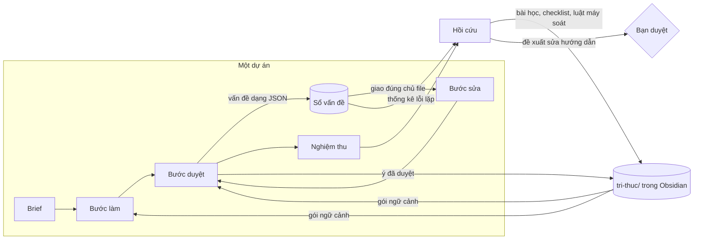

# Kế hoạch nâng cấp "trí não" cho Yoga Lab

Ngày 19/10/2026. Dựa trên mã `server.js` và dữ liệu thật trong `workspace/`: 87 lượt chạy, 11 kế hoạch, 7 file `kinh-nghiem.md`, hơn 60 bàn giao.

## 0. Tóm tắt

Yoga Lab đã có khung tốt: máy chủ điều phối, brief và bảng dự án, bàn giao 7 mục, vòng duyệt tự động, nghiệm thu chấm điểm, bài học ghi vào `kinh-nghiem.md`.
Chỗ yếu nằm ở **trí nhớ**. Mỗi dự án gần như làm lại từ đầu. Bài học là một danh sách chữ, không ai đo xem nó có tác dụng không.
Các agent "nói chuyện" với nhau bằng văn xuôi mà máy chủ không hiểu.

Đề xuất xây 4 lớp nhớ. Lớp quan trọng nhất là **kho tri thức dạng Obsidian** (`tri-thuc/`), dùng chung cho mọi agent và cho chính bạn.

| Lớp | Trả lời câu hỏi | Hiện có | Cần thêm |
|---|---|---|---|
| Làm việc | Bước này cần đọc gì? | brief, bảng dự án, bàn giao | Gói ngữ cảnh do máy chủ soạn |
| Dự án | Còn lỗi gì, ai phải sửa? | văn xuôi trong file nhận xét | **Sổ vấn đề** có cấu trúc |
| Tri thức | Nhóm đã biết chắc điều gì? | không có (rải rác trong v2…v7) | **Kho tri thức Obsidian** |
| Kinh nghiệm | Lần trước sai ở đâu, tránh thế nào? | `kinh-nghiem.md` | **Bài học có vòng đời**, tự thăng cấp thành checklist hoặc luật máy soát |

Thứ tự: P0 dọn nền → P1 sổ vấn đề → P2 kho tri thức → P3 vòng tự học → P4 gói ngữ cảnh → P5 đo lường.
P0 và P1 có tác dụng ngay ở dự án kế tiếp. P2 là phần "trí não" lớn nhất.

## 1. Hiện trạng: dữ liệu nói gì

### Đang tốt, giữ nguyên
- Máy chủ là người điều phối duy nhất, agent không tự gọi nhau, nên kiểm soát được chi phí và thứ tự.
- Máy soát lỗi (`lintText`) không tốn token và đã bắt được lỗi người duyệt bỏ sót.
- Nghiệm thu chấm theo tiêu chí, có bằng chứng (xem `du-an/plan-20261017-170653/nghiem-thu.md`). Bài học viết cụ thể.

### Vấn đề 1: mỗi phiên bản nghiên cứu lại từ đầu, và ngày càng tốn hơn
- Cùng chủ đề suy giáp đã làm 6 lần (v2 → v7). Token quy đổi bước nguồn của Mai: v5 0,60 triệu → v6 1,23 triệu → v7 2,14 triệu.
- An mở lại các link đã kiểm ở bản trước (trung bình 5,9 lần WebFetch/WebSearch mỗi lượt).
- Mai tốn nhiều token nhất (27,7 triệu tổng, 4,8 triệu quy đổi) và lỗi 6/19 lượt, phần lớn vì Chrome chưa cấp quyền nhưng tới lúc chạy mới biết.
- Không có chỗ lưu "ý đã kiểm chứng + câu trích + nguồn" để bản sau dùng lại.

### Vấn đề 2: bài học không biến thành hành vi
- Bài học chỉ được ghi lúc nghiệm thu (`finishPlan`), dồn vào một danh sách phẳng, rồi cắt theo **độ mới**: `trimLessons` giữ 30 dòng gần nhất, không xét bài nào có giá trị hơn.
- Bài học trùng lặp vì chỉ so 80 ký tự đầu (`qKey`). Mai có 2 bài về số 115, An có 2 bài gần như y hệt.
- Cùng một lỗi lặp lại dù đã có bài học:
  - "Ảnh tốt chưa nằm trong `hinh/`": có trong bài học của Hạ (2 bài), Nhi (2), Chef (1).
  - "Lỗi trong slides.md nhưng không ai giao Lam sửa" (`CẦN GIAO LAM`): Hạ, Chef, Lam đều có; lặp từ v5 sang v6.
  - "115 chưa có nguồn Việt Nam": Mai (2), An (2); lặp v5 → v6, tới v7 mới xong.
- Mấy lỗi trên máy kiểm được (file có tồn tại không, hai file có khớp không), nhưng hệ thống vẫn trông vào trí nhớ của agent.
- Mọi agent đọc toàn bộ bài học ở mọi lượt, kể cả bài không liên quan (bài về duyệt ảnh của Hạ vẫn hiện khi Hạ biên tập chữ).

### Vấn đề 3: giao tiếp bằng văn xuôi
- Nhận xét duyệt nằm trong `agents/<người duyệt>/...`. Người sửa phải đọc hết, người duyệt lại phải đọc lại.
  Từ bước duyệt, máy chủ chỉ đọc được dòng `KẾT LUẬN` và mục câu hỏi.
- Vòng sửa luôn trả về người làm bước được duyệt (`handleReview`), kể cả khi lỗi nằm trong file của người khác.
- Bàn giao có thể báo "đã sửa" khi file chưa đổi (bài học của Hạ và Lam), trong khi máy chủ biết chính xác lượt đó đã ghi file nào (`run.files`).

### Vấn đề 4: quyết định của chủ dự án không được nhớ
- Câu trả lời chỉ sống trong một kế hoạch. Câu "115 chưa có nguồn" bị hỏi ít nhất 4 lần qua 2 dự án.
  Câu "biểu tượng Canva có tính là hình có giấy phép không" bị hỏi 3 lần trong một dự án, mỗi lần một cách viết, nên bộ so trùng theo chữ không bắt được.
- Kế hoạch v6 dùng hết 3 lượt hỏi, 10 câu sau đó bị bỏ qua tự động.

### Vấn đề 5: `index.md` phình ra
- 85 dòng và tăng sau mỗi lượt, vì quy tắc 5 trong `buildPrompt` bảo agent tự thêm dòng.
  Mọi lượt đều đọc file này đầu tiên, mà phần lớn là file của v2–v6 đã cũ.

## 2. Kiến trúc đích



Nguyên tắc:
1. **Máy chủ vẫn là người điều phối duy nhất.** Agent "nói" với nhau qua dữ liệu có cấu trúc. Máy chủ hiểu dữ liệu đó và chuyển tới đúng người. Không agent nào gọi thẳng agent khác, nên vẫn giữ được ngân sách và thứ tự.
2. **Việc gì máy làm được thì để máy làm**, không tốn token: kiểm link sống hay chết, kiểm file có tồn tại không, đối chiếu hai file, sinh index, gộp bài học trùng.
3. **Tri thức là file Markdown thuần có frontmatter.** Agent đọc bằng Grep/Read như hiện nay, bạn đọc và sửa bằng Obsidian, Git giữ lịch sử.
4. **Mọi thay đổi vào hướng dẫn của agent đều phải qua bạn duyệt.** Hệ thống tự học nhưng không tự đổi hướng.

## 3. Lộ trình

### P0 · Dọn nền (nhỏ, có lợi ngay)

| # | Việc | Sửa ở đâu | Lợi |
|---|---|---|---|
| 0.1 | Máy chủ tự sinh `index.md` từ dữ liệu nguồn gốc file (đã có `originIndex`): mỗi chủ đề chỉ ghi bản mới nhất và link dự án; phần cũ chuyển sang `luu-tru/index-cu.md`. Bỏ quy tắc "tự thêm dòng vào index.md". | `buildPrompt`, thêm `writeIndex()` gọi sau `finishRun` | Mọi lượt đọc ít hơn; agent không còn ghi chồng lên nhau trong index |
| 0.2 | So trùng gần đúng cho bài học và câu hỏi: tách từ, bỏ dấu câu, Jaccard ≥ 0,6 thì coi là trùng. | `appendLessons`, `newQuestions` | Hết bài học đôi, hết hỏi câu Canva 3 lần |
| 0.3 | **Sổ quyết định bền vững** `tri-thuc/quyet-dinh.md`. Mọi câu chủ dự án trả lời (kể cả "nhóm tự quyết") được ghi kèm chủ đề. Khi lập kế hoạch mới, quyết định cùng chủ đề được đưa vào prompt điều phối và mục "Quyết định đã chốt" của brief. Câu hỏi mới giống quyết định cũ thì tự trả lời. | `answerPlan`, `newQuestions`, `buildPlanPrompt` | Không hỏi lại chuyện 115, Canva, Viparita… |
| 0.4 | Kiểm lời khai của bàn giao. Bước sửa mà không ghi vào file sản phẩm được giao thì máy chủ ghi vào bảng dự án và báo cho người duyệt lại ("bước sửa không làm thay đổi slides.md"). | `pumpPlan` (phần `onDone`) | Máy bắt lỗi "báo đã sửa mà file chưa đổi" |
| 0.5 | Kiểm trước khi chạy: kế hoạch có agent dùng Chrome thì máy chủ thử kết nối bằng một lượt rất ngắn trước bước đầu; hỏng thì báo ngay. | `createPlan`, `resumePlan` | Tránh kiểu 6 lượt lỗi của Mai |

### P1 · Sổ vấn đề: giao tiếp có cấu trúc

Mục tiêu: người duyệt, người sửa và máy chủ dùng chung một ngôn ngữ.

**1.1 Người duyệt trả vấn đề dạng JSON**, ở cuối bàn giao, giống khối JSON của nghiệm thu:
```json
{"van_de": [
  {"file": "output/suy-giap-v7/slides.md", "vi_tri": "Trang 13", "muc": "BẮT BUỘC",
   "loai": "thieu-nguon", "mo_ta": "Số 115 chưa có nguồn", "de_xuat": "Dẫn trang công khai của Bộ Y tế"}
]}
```
`loai` lấy trong danh mục cố định (mục 3.3) để thống kê được.

**1.2 Máy chủ ghi vào `du-an/<mã>/van-de.md`**: bảng gồm mã (V-001), file, vị trí, mức, loại, người phát hiện, **người phải sửa**, trạng thái, bước.
Người phải sửa suy ra từ **chủ của file**: `slides.md` → Lam, `thiet-ke.md` → Vy, `agents/mai/*-nguon.md` → Mai, ảnh trong `hinh/` → Nhi.
Bảng chủ file đặt trong config; mặc định lấy người đã ghi file đó trong dự án.

**1.3 Vòng sửa giao theo vấn đề.** `handleReview` chèn bước sửa cho **từng người còn vấn đề mở**, không chỉ người làm bước được duyệt.
Đây là cách chữa tận gốc lỗi "CẦN GIAO LAM", thay vì trông vào việc Chef nhớ bài học.

**1.4 Người sửa báo trạng thái từng vấn đề**: `{"da_xu_ly": [{"ma": "V-003", "trang_thai": "da-sua", "ly_do": ""}]}`, trạng thái là `da-sua` hoặc `khong-sua`.
Máy chủ đối chiếu với kiểm tra 0.4 (file có thật sự thay đổi không).

**1.5 Bước duyệt lại chỉ nhận danh sách vấn đề còn mở**, kèm vị trí, thay vì cả file nhận xét. Bước duyệt lại ngắn hơn và rẻ hơn.

**1.6 Nhắn đồng đội**: mục tuỳ chọn `## Gửi đồng đội` trong bàn giao, mỗi dòng dạng `@lam: …`.
Nếu là lỗi, máy chủ chuyển thành vấn đề. Nếu là thông tin, máy chủ đính kèm vào bước kế tiếp của người đó.
Không ai phải đọc bàn giao của người khác để tìm việc của mình.

**1.7 (Tuỳ chọn, thử sau) Hỏi nhanh đồng nghiệp**: agent ghi câu hỏi cho đồng nghiệp (`@an hỏi: Mayo có cho trích nguyên văn không?`).
Máy chủ chạy một lượt rất ngắn của người được hỏi (effort thấp, tối đa 4 lượt, chỉ đọc file của họ) và ghi câu trả lời vào bảng dự án.
Giới hạn số lần mỗi dự án để không đội token.

Thẻ trên Bảng việc hiện thêm số vấn đề còn mở.

### P2 · Trí não chung trong Obsidian (`tri-thuc/`)

Mục tiêu: điều nhóm đã kiểm chứng thì không phải tìm lại. Bạn mở Obsidian là thấy nhóm đang "biết" những gì.

**Cấu trúc**
```
workspace/tri-thuc/
├── 00-ban-do.md          ← bản đồ chính (máy chủ sinh)
├── chu-de/suy-giap.md    ← MOC chủ đề: mệnh đề, tư thế, nguồn, hình, dự án, quyết định
├── menh-de/              ← mỗi ý y khoa đã kiểm chứng là một note
├── nguon/                ← mỗi nguồn một note: link, tổ chức, tình trạng truy cập, câu trích
├── tu-the/               ← mỗi tư thế: chống chỉ định, đạo cụ, biến thể, prompt ảnh đã đạt, lỗi AI hay vẽ sai
├── hinh/                 ← thư viện hình có giấy phép: link tải thẳng, tác giả, giấy phép, vùng nhãn cần che
├── quyet-dinh/           ← quyết định bền vững của chủ dự án (thay cho file đơn ở P0.3)
├── thuat-ngu.md          ← từ nên dùng, từ cần tránh → máy chủ đọc ra lintBanned, lintVariants
├── mau-tot/              ← ví dụ đạt chuẩn (P3.8)
└── bai-hoc/              ← bài học có vòng đời (P3)
```

**Ví dụ note mệnh đề** `menh-de/levothyroxine-uong-luc-doi.md`:
```markdown
---
loai: menh-de
chu-de: [suy-giap, thuoc]
muc-bang-chung: manh          # manh | vua | so-bo | y-kien
trang-thai: da-duyet          # nhap | da-duyet | can-xem-lai | bac-bo
nguon: ["[[nhs-levothyroxine]]"]
trich: "30 minutes to 1 hour before breakfast"
duyet-boi: an
ngay-duyet: 2026-10-19
xem-lai-truoc: 2027-10-19
dung-trong: ["[[plan-20261019-193827]]"]
---
Uống levothyroxine lúc đói, 30–60 phút trước bữa sáng.

## Cách nói trên slide
"Uống thuốc lúc bụng đói, theo giờ bác sĩ dặn."

## Lưu ý
Không nói "cách 4 giờ" chung chung: 4 giờ chỉ áp dụng cho canxi carbonate và sắt sulfate.
```

**Note nguồn** `nguon/nhs-levothyroxine.md`: `url`, `to-chuc`, `loai-nguon`, `truy-cap` (ok, 403, 404, captcha), `kiem-luc`,
`cach-mo-khac` (ví dụ Europe PMC cho bài PMC), các câu trích đã dùng.

**Note tư thế** `tu-the/viparita-karani.md`: chống chỉ định (có nguồn hay chỉ là ý kiến), đạo cụ, bản nhẹ, thời gian giữ đã dùng,
**prompt ảnh đã đạt**, lỗi AI hay mắc (thừa bàn chân gần hông, bắp chân lơ lửng).
Phần lớn bài học của Nhi nên chuyển về đây, vì đó là tri thức về tư thế chứ không phải về riêng Nhi.

**Ai ghi, ghi lúc nào**

| Thời điểm | Ghi gì | Ai làm |
|---|---|---|
| An kết luận ĐẠT ở bước duyệt nguồn | Mệnh đề đã duyệt, nguồn, câu trích | An trả khối JSON `menh_de`; **máy chủ** viết note (định dạng thống nhất, không tốn lượt) |
| Sau mỗi dự án, hoặc mỗi đêm | Kiểm link trong `nguon/`, cập nhật `truy-cap` | Máy chủ (HTTP GET, giống cách đang tải hình) |
| Máy chủ tải được hình | Thêm note vào `hinh/` | Máy chủ |
| Chủ dự án trả lời câu hỏi | Note trong `quyet-dinh/` | Máy chủ |
| Nghiệm thu xong | Cập nhật MOC chủ đề, gắn dự án | Máy chủ |
| Bất cứ lúc nào | Đổi `trang-thai: bac-bo`, thêm ghi chú của bác sĩ | Bạn, trong Obsidian |

**Agent dùng kho thế nào**
- **Mai**: trước khi tìm, đọc `chu-de/<chủ đề>.md`. Chỉ tìm cho mục **chưa có mệnh đề đã duyệt, hoặc đã quá hạn xem lại** (nghiên cứu phần chênh). Deep Research chỉ chạy cho phần còn trống.
- **An**: mệnh đề đã duyệt và còn hạn thì không mở lại link; chỉ kiểm mệnh đề mới hoặc vừa sửa. Tình trạng link lấy từ note nguồn, máy chủ đã kiểm sẵn.
- **Lam**: trích theo mệnh đề; dòng nguồn trên slide lấy từ note nguồn, nên hết cảnh số [n] lệch giữa file nguồn và kịch bản (bài học của Mai).
- **Vy, Nhi**: lấy hình từ `hinh/`, prompt từ `tu-the/`.

**Phần dành cho bạn trong Obsidian**
- Graph view: thấy mệnh đề nào dựa trên nguồn nào, dự án nào đã dùng.
- Plugin Dataview (plugin cộng đồng) cho các bảng: mệnh đề `can-xem-lai`; mệnh đề mức `y-kien` nằm trên trang an toàn; nguồn đang trả 403; tư thế chưa có ảnh đạt.
- Đặt `workspace` trỏ vào vault (README đã hỗ trợ), hoặc mở thẳng `workspace/` làm vault.

**Kho ban đầu**: nhập từ `agents/an/suy-giap-v7-*.md` ("Danh sách đã duyệt") và `agents/mai/suy-giap-v7-nguon.md`, nên không bắt đầu từ số 0.

**Chống tri thức sai lan rộng**
- Chỉ An (người kiểm chứng) được đưa mệnh đề lên `da-duyet`, và phải có câu trích.
- Mỗi mệnh đề có hạn xem lại.
- Mệnh đề `bac-bo` mà còn xuất hiện trong sản phẩm thì máy soát gắn cờ.
- Mỗi dự án, bước duyệt vẫn kiểm ngẫu nhiên vài mệnh đề cũ.

### P3 · Vòng tự học

Mục tiêu: lỗi đã xảy ra thì lần sau không lặp lại. Nếu vẫn lặp, hệ thống tự siết thêm một bậc.

**3.1 Học từ mọi vòng duyệt, không chỉ lúc nghiệm thu.** Mỗi vấn đề BẮT BUỘC trong sổ vấn đề là một tín hiệu để học: ai gây ra, loại lỗi gì, ở bước nào.

**3.2 Bài học có vòng đời** (`tri-thuc/bai-hoc/<mã>.md`, hoặc một bảng chung):
```yaml
ma: BH-017
pham-vi: vai:bien-tap        # nhom | vai:<vai> | agent:<id> | chu-de:<chủ đề>
ap-dung-khi: [duyet, hinh]   # loại bước, loại file
loai-loi: anh-sai-thu-muc
tu-van-de: [V-031, V-058]
bac: 1                       # 1 bài học · 2 checklist · 3 máy kiểm · 4 đổi quy trình
lan-tai-pham: 2
trang-thai: khong-hieu-qua   # moi | hieu-qua | khong-hieu-qua | da-thang-cap | huy
```

**3.3 Danh mục loại lỗi cố định**, khởi đầu từ dữ liệu hiện có:
`thieu-nguon`, `nguon-khong-khop`, `phong-dai`, `an-toan-thieu-ccd`, `lech-hai-file`, `file-khong-ton-tai`, `anh-sai-tu-the`,
`anh-sai-thu-muc`, `chinh-ta-dau-cau`, `qua-chu`, `thieu-muc-brief`, `link-chet`, `bao-cao-sai-su-that`.

**3.4 Thang thăng cấp**, cốt lõi của "tự học":

| Bậc | Hình thức | Khi nào lên bậc | Ví dụ từ dữ liệu |
|---|---|---|---|
| 1 | Bài học chữ, chỉ hiện ở đúng loại bước | mặc định | "Đọc lại từng ý như một câu trọn nghĩa" |
| 2 | Dòng bắt buộc trong mục "Tự kiểm" của bàn giao | lỗi lặp lại sau khi đã có bài học | "Đã đối chiếu dòng Hình của mọi trang tư thế với thiet-ke.md" |
| 3 | Luật máy soát hoặc kiểm tra của máy chủ | vẫn lặp ở bậc 2, và máy kiểm được | Ảnh trong "Danh sách hình" phải có thật trong `hinh/`; dòng Hình trong slides.md phải khớp thiet-ke.md |
| 4 | Đổi quy trình hoặc hướng dẫn vai | Chef đề xuất, bạn duyệt | Chèn bước "kiểm file hình" trước bước duyệt ảnh |
| (khác) | Chuyển thành tri thức | khi bài học thật ra là một sự thật | "115 cần nguồn Bộ Y tế" thành note `menh-de` có nguồn, không còn là bài học |

**3.5 Đo hiệu quả.** Sau mỗi dự án, với mỗi bài học có `loai-loi`, máy chủ đếm vấn đề cùng loại trong cùng phạm vi.
Không còn thì đánh `hieu-qua`. Còn thì `lan-tai-pham` cộng 1 và đề xuất lên bậc.

**3.6 Hồi cứu sau dự án**, thay cho mục "lessons" trong nghiệm thu hiện nay.
Chef nhận số liệu máy chủ đã tổng hợp (vấn đề theo loại, theo người, bài học tái phạm) và trả về JSON gồm:
bài học cần gộp hoặc viết lại, đề xuất lên bậc, và đề xuất **sửa hướng dẫn riêng** của từng agent dưới dạng dòng cũ → dòng mới.

**3.7 Bạn duyệt đề xuất.** Giao diện có thêm mục **Đề xuất cải tiến**, mỗi đề xuất là một thẻ với ba nút Duyệt / Sửa / Bỏ.
Duyệt thì máy chủ ghi vào config và giữ bản cũ để hoàn tác. Hướng dẫn của agent không bao giờ tự đổi khi bạn chưa duyệt.

**3.8 Mẫu tốt.** Bài học tích cực ("làm tốt, giữ lại") và sản phẩm được chấm cao được lưu thành ví dụ trong `tri-thuc/mau-tot/`:
một trang slide đạt, một prompt ảnh đạt, một file kiểm chứng gọn. Agent đọc một ví dụ đúng loại thay vì đọc một đoạn mô tả dài.

### P4 · Gói ngữ cảnh và Thủ thư

**4.1 Gói ngữ cảnh.** Thay cho "đọc index.md + đọc kinh-nghiem.md", máy chủ soạn sẵn cho từng bước một khối ngắn (tối đa khoảng 2.000 từ):
- quyết định đã chốt của chủ đề;
- bài học bậc 1–2 có `ap-dung-khi` khớp với bước này (không phải cả 30 bài);
- vấn đề đang mở giao cho người này;
- danh sách mệnh đề, tư thế, hình liên quan: chỉ tên và đường dẫn, cần thì agent tự Read.

Truy hồi bằng thẻ và từ khoá trên frontmatter. Với vài trăm note thì chưa cần vector DB.

**4.2 Thủ thư (tuỳ chọn).** Phần lớn việc giữ kho do máy chủ làm.
Chỉ khi cần tóm lược (gộp mệnh đề trùng, viết lại MOC chủ đề cho dễ đọc) mới thêm agent "Thủ thư" chạy Haiku, effort thấp, sau mỗi dự án.
Nếu máy chủ làm đủ ở P2 thì bỏ qua bước này.

**4.3 Chế độ tiếp nối.** Khi giao dự án mới cho chủ đề đã có (ví dụ v8), điều phối viên nhận bản cuối gần nhất,
mục "Phần còn thiếu" của nghiệm thu và kho tri thức của chủ đề. Họ lập kế hoạch **chỉ cho phần chênh**, không làm lại từ đầu.
Hiện mỗi phiên bản là một thư mục output đầy đủ (113 MB cho 6 bản).

### P5 · Đo lường

Thêm vào trang Báo cáo, hoặc làm note Dataview trong Obsidian:
- tỉ lệ dùng lại tri thức: số mệnh đề dùng lại so với số mệnh đề mới, theo từng dự án;
- vấn đề theo loại × người × dự án, và loại nào đang tái phạm;
- bài học: bao nhiêu bài đang hiệu quả, đang tái phạm, đã thăng cấp;
- token theo loại bước (làm, duyệt, sửa, duyệt lại), số vòng sửa, điểm nghiệm thu lần đầu.

Chỉ tiêu cho dự án kế tiếp cùng chủ đề:

| Chỉ số | Hiện tại (v6, v7) | Mục tiêu |
|---|---|---|
| Token quy đổi bước nguồn của Mai | 2,1 triệu | dưới 1 triệu |
| Câu hỏi lặp lại gửi chủ dự án | ít nhất 4 | 0 |
| Lỗi cùng loại đã có bài học bậc 2 trở lên | lặp nhiều lần | 0 |
| Điểm nghiệm thu lần đầu | 80–87 | từ 85, không cần vòng sửa lớn |
| `index.md` | 85 dòng, tăng mãi | dưới 30 dòng, ổn định |

## 4. Ý tưởng thêm

- **Chạy song song các bước độc lập.** Trường `from` đã cho ra đồ thị phụ thuộc. Hai bước không phụ thuộc nhau và do hai người khác nhau làm thì chạy cùng lúc
  (ví dụ Vy dựng khung thiết kế trong khi An duyệt kịch bản). Hiện `pumpPlan` chạy tuần tự từng bước.
- **Chọn model theo loại bước.** Duyệt lại những lỗi máy móc thì chạy Haiku; giữ Sonnet hoặc Opus cho bước làm và bước duyệt lần đầu.
- **Máy đối chiếu hai file.** So từng trang slides.md với thiet-ke.md (dòng Hình, đạo cụ, thời gian giữ). Lỗi này xuất hiện ở cả v5 và v6.
- **Ảnh tư thế thật.** Tư thế nào AI vẽ sai nhiều lần (tr.17) thì ghi "cần ảnh thật" vào note tư thế, lần sau đi thẳng phương án đó.
- **Tách mã.** `server.js` đã khoảng 150 KB. Phần mới nên đặt trong `lib/` (ví dụ `lib/tri-thuc.js`, `lib/van-de.js`, `lib/bai-hoc.js`) để dễ đọc và dễ kiểm thử.

## 5. Rủi ro

| Rủi ro | Cách chặn |
|---|---|
| Tri thức sai lan sang mọi dự án sau | Chỉ An đưa lên `da-duyet`; bắt buộc câu trích; có hạn xem lại; bạn đánh `bac-bo` được; mỗi dự án kiểm ngẫu nhiên vài mệnh đề cũ |
| Hướng dẫn agent dần lệch đi vì tự sửa | Mọi thay đổi hướng dẫn qua bạn duyệt; lưu phiên bản để hoàn tác |
| Gói ngữ cảnh làm prompt dài thêm | Giới hạn cứng số từ; chỉ đưa tên và đường dẫn, agent tự Read khi cần |
| Bạn sửa note trong Obsidian đúng lúc máy chủ ghi | Máy chủ chỉ ghi các trường của nó và ghi nguyên tử; note có `khoa: true` thì máy chủ không ghi |
| Kho tri thức bị coi như thay cho bác sĩ | Mục "Việc cần người thật kiểm tra" giữ nguyên; mệnh đề mức `y-kien` trên trang an toàn luôn bị gắn cờ |

## 6. Đề xuất bắt đầu

1. **Toàn bộ P0 và P1.1–1.5** trong một đợt. Chủ yếu sửa máy chủ, thử ngay ở dự án kế tiếp.
2. **P2 cho riêng chủ đề suy giáp**: nhập kho ban đầu từ v7, rồi thử chế độ tiếp nối (4.3) cho v8.
3. **P3** sau khi đã có 1–2 dự án ghi sổ vấn đề, vì cần dữ liệu thật để đo hiệu quả của bài học.
