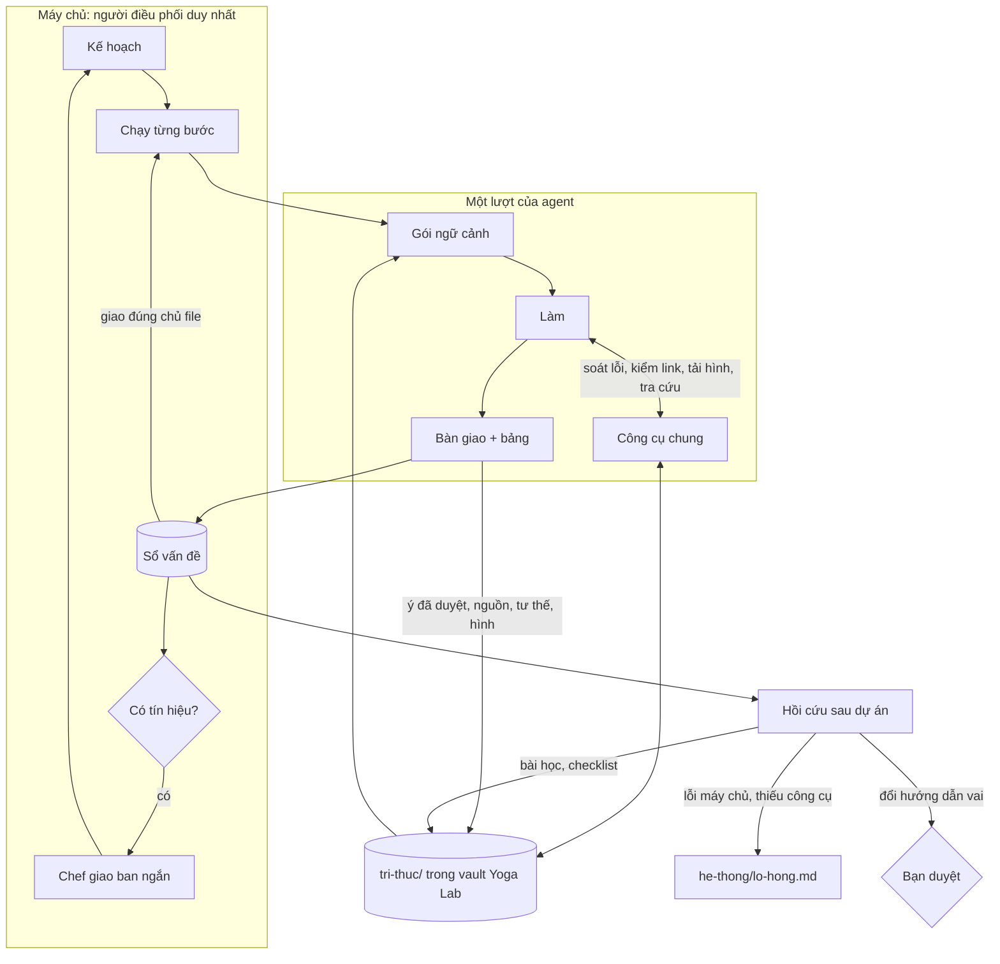

# Kế hoạch nâng cấp trí não Yoga Lab · bản 3

Ngày 19/10/2026. Bản này thay bản 2.
Số liệu lấy từ `workspace/.yogalab/runs.jsonl` (87 lượt chạy), `plans.json` (11 kế hoạch), các file bàn giao, file nhận xét và `kinh-nghiem.md`.

File này nói **vì sao** và **làm gì**. Cách làm từng bước, đủ chi tiết để triển khai, nằm trong [docs/trien-khai/](trien-khai/README.md).

## Đã chốt với chủ dự án

| Câu hỏi | Quyết định | Ghi chú |
|---|---|---|
| Vault Obsidian | **Vault riêng**: mở chính `workspace/` thành vault "Yoga Lab" | Agent và máy chủ thấy đúng file bạn thấy; agent không đụng ghi chú cá nhân; tên note không lẫn; hơn 100 MB ảnh không làm nặng vault chính. Muốn gộp vào vault chính sau này thì chuyển thư mục và sửa `workspace` trong config |
| Câu hỏi cho chủ dự án | **Vẫn làm dự án dừng chờ**, như hiện nay | Chỉ bớt hỏi trùng, gợi ý sẵn câu trả lời cũ, và tách câu hỏi về môi trường (Chrome, đăng nhập) thành tạm dừng kèm cách sửa |
| Công cụ của máy chủ qua MCP | **Đồng ý** | Agent vẫn không có Bash |
| Dự án chạy thử | **Chủ đề mới** | Đo phần dùng lại liên chủ đề: tư thế, nguồn, tình trạng link, thuật ngữ, quy tắc của bạn |
| Mức chi tiết | Kế hoạch dừng ở mức đặc tả; triển khai sau, ở mức suy luận thấp hơn | Vì vậy đặc tả ghi tới tên hàm, câu dặn agent nguyên văn, dữ liệu mẫu và kết quả kiểm thử đã chạy thử |

Còn một nút bạn tự chỉnh nếu muốn: máy chủ hiện chỉ dừng hỏi tối đa `maxAskRounds = 3` lần mỗi dự án; từ lần thứ 4, nhóm tự quyết theo đề xuất. Muốn mọi câu đều dừng thì tăng số này trong `config.json`.

## 0. Tóm tắt

### Năm phát hiện
1. **Chi phí ≈ số lượt × độ dài ngữ cảnh.** 91% token là đọc lại cache. Mỗi lượt thừa đều đọc lại toàn bộ ngữ cảnh: chờ trang Gemini, thử lệnh bị chặn, mở lại link cũ.
2. **Sửa lỗi muộn đắt hơn làm đúng từ đầu.** Vòng duyệt → sửa → duyệt lại tốn ngang hoặc hơn chính bước làm.
3. **Nhóm làm lại cùng một việc.** Suy giáp đã làm 6 bản. Khoảng 40% link mở ở v6 và v7 đã được mở ở bản trước. 11/12 ý tiêu biểu đã duyệt ở v7 đã có trong file kiểm chứng v6.
4. **Phần lớn bài học lặp lại không phải lỗi của agent.** 25/67 bài học có gốc là máy chủ, công cụ, quy trình, môi trường hoặc tri thức. 17/67 bài sẽ được chữa thẳng bằng thay đổi hệ thống ở Đợt 0–2.
5. **Bạn gần như luôn để nhóm tự quyết** (26/27 câu hỏi), và nhiều câu bị hỏi trùng: số 115 bị hỏi 4 lần, biểu tượng Canva 3 lần, trong cùng một dự án.

### Năm trụ cột

| Trụ cột | Ý chính |
|---|---|
| T1 · Công cụ chung (MCP) | Agent gọi được 4 công cụ của máy chủ ngay trong lượt: `soat_loi`, `kiem_link`, `tai_hinh`, `tra_cuu`. Không mở Bash |
| T2 · Sổ vấn đề | Lỗi ghi theo bảng cố định cột, tự giao đúng người phụ trách file. Bước duyệt lại chỉ kiểm vấn đề còn mở. Agent nhắn nhau qua bàn giao. Chef chỉ "giao ban" khi có tín hiệu |
| T3 · Bộ não Obsidian | `workspace/tri-thuc/` trong vault riêng: ý đã kiểm chứng, nguồn, tư thế, hình, quyết định, thuật ngữ, quy tắc của bạn |
| T4 · Tự học có phân loại gốc lỗi | Lỗi đi tới đúng nơi sửa theo gốc. Bài học có vòng đời, chỉ hiện đúng loại bước. Lỗi tái phạm thì tự lên bậc. Hướng dẫn vai chỉ đổi khi bạn duyệt |
| T5 · Kinh tế token | Người làm tự soát trước khi bàn giao, duyệt lại hẹp, nghiên cứu phần chênh. Đợt 4: Deep Research hai pha, chế độ tiếp nối, model theo bước |

Giữ nguyên nguyên tắc hiện tại: **máy chủ là người điều phối duy nhất, agent không gọi nhau trực tiếp.**

### Thứ tự

| Đợt | Nội dung | Kết quả thấy được |
|---|---|---|
| 0 | Sửa 7 lỗi hệ thống; khung kiểm thử; `index.md` do máy chủ viết; sổ quyết định; kiểm Chrome trước khi chạy; đường ống MCP + `soat_loi` (tắt sẵn) | Hết hỏi trùng, hết ảnh rơi vào `hinh-moi/`; bạn thử MCP trên máy |
| 1 | Sổ vấn đề, giao theo chủ file, duyệt lại hẹp, tin nhắn, giao ban, `kiem_link`, `tai_hinh` | Dự án thử 1 (chủ đề mới) |
| 2 | Bộ não `tri-thuc/`, nhập tri thức v7, `tra_cuu`, gói ngữ cảnh, thuật ngữ, quy tắc của bạn | Bạn mở vault thấy bộ não; dự án thử 2 |
| 3 | Gốc lỗi, bài học có vòng đời, hồi cứu, đề xuất cải tiến, lỗ hổng hệ thống | Đề xuất cải tiến hiện ở cửa sổ Dự án |
| 4 | Deep Research hai pha, model theo bước, chạy song song, tiếp nối, hỏi nhanh đồng nghiệp, chỉ số | Bật từng cái, so với mục tiêu |

## 1. Phát hiện

### 1.1 Token đi đâu

| Loại token (87 lượt) | Token thô | Phần trong token quy đổi |
|---|---|---|
| Đọc cache | 64,5 triệu (91% token thô) | khoảng 50% (tính 1/10) |
| Ghi cache | 4,7 triệu | khoảng 37% |
| Đầu ra | 1,4 triệu | khoảng 11% |
| Đầu vào mới | 0,3 triệu | khoảng 2% |

Ba nguồn lượt thừa lớn nhất:
- **Chờ trên Chrome.** Trong các lượt Mai dùng Chrome, khoảng 45% thao tác là chờ hoặc tải lại trang Gemini. Mỗi lần chờ đọc lại khoảng 44 nghìn token ngữ cảnh.
  Mai và Nhi tốn nhất mỗi lần chạy: 250 nghìn và 268 nghìn token quy đổi. Nhi trung bình 59 lượt mỗi lần chạy.
- **Thử công cụ không được cấp.** 46/87 lần chạy (53%) có gọi Bash (chưa tính PowerShell) để đếm chữ, ghi file, liệt kê thư mục. Lần nào cũng bị từ chối và mất lượt.
  Bàn giao ghi rõ: "Không chạy được python để đếm chữ, đếm tay" (Lam, An), "không có công cụ tải" (Vy), "không chạy được script tải hình" (Mai).
- **Vòng sửa** (ước tính theo lượt chạy của từng bước):

| Kế hoạch | Bước làm | Duyệt + sửa + duyệt lại |
|---|---|---|
| v5 (plan-20261016-204631) | 0,40 triệu | 1,70 triệu |
| v6 (plan-20261017-170653) | 1,68 triệu | 1,82 triệu |
| v7 (đang tạm dừng) | 1,68 triệu | 0,81 triệu, chưa xong |

### 1.2 Làm lại cùng một việc
- Suy giáp có 6 bản (v2 → v7), bản nào cũng làm lại từ đầu. Thư mục output đã 113 MB.
- Link mở ở v6: khoảng 10/23 đã được mở ở bản trước. v7: khoảng 12/33.
- Token quy đổi bước nguồn của Mai tăng dần: v5 0,60 → v6 1,23 → v7 2,14 triệu.
- 11/12 ý tiêu biểu trong "Danh sách đã duyệt" của v7 đã có trong file kiểm chứng v6.

### 1.3 Bài học lặp lại: gốc lỗi thật nằm ở đâu

| Lỗi lặp lại | Có trong bài học của | Gốc lỗi thật | Chỗ sửa đúng |
|---|---|---|---|
| Ảnh tốt nằm ở `hinh-moi/`, không vào `output/<chủ đề>/hinh/` | Hạ (2), Nhi (2), Chef (1) | **Máy chủ**: `imageDirOf` lấy thư mục từ chữ trong nhiệm vụ | Đợt 0 |
| Lỗi trong slides.md mà không ai giao Lam sửa (`CẦN GIAO LAM`) | Hạ, Chef, Lam | **Quy trình**: `handleReview` chỉ giao sửa cho người làm bước được duyệt | Đợt 1 |
| Số 115 chưa có nguồn Việt Nam | Mai (2), An (2) | **Tri thức**: một sự thật phải tìm lại mỗi bản | Đợt 2 |
| Đếm chữ trên slide bằng tay, đếm sai | Lam, An | **Công cụ**: agent không có công cụ đếm | Đợt 0 (`soat_loi`) |
| Dòng Hình trong slides.md lệch thiet-ke.md | Lam (3), Hạ (1) | **Công cụ và quy trình** | Đợt 0 (máy đối chiếu hai file), Đợt 1 |
| StatPearls, Mayo, NICE trả 403 hoặc CAPTCHA | An, Hạ, Mai | **Môi trường và tri thức** | Đợt 1–2 (note nguồn) |
| Bàn giao báo "đã sửa" mà file chưa đổi | Hạ, Lam | **Agent**, nhưng máy kiểm được | Đợt 0–1 |
| Ý trên slide thiếu tân ngữ, câu cụt | Lam | **Agent** | Bài học, đúng chỗ |

Chạy thử luật phân loại (Đợt 3) trên cả 67 bài học hiện có, theo gốc:

| Gốc | agent | quy-trinh | cong-cu | moi-truong | tri-thuc |
|---|---|---|---|---|---|
| Số bài | 42 | 10 | 7 | 4 | 4 |

Có 17 bài sẽ không còn cần nằm trong lời dặn agent nữa, vì hệ thống đã chữa thẳng gốc lỗi.

### 1.4 Kế hoạch tĩnh, tín hiệu giữa chừng không ai xử lý
Chef chia việc một lần lúc đầu, rồi chỉ được gọi lại khi có bước lỗi hoặc lúc nghiệm thu. Trong lúc đó, những tín hiệu cần xử lý ngay bị bỏ qua:
- "Dòng Hình chưa đối chiếu được với thiet-ke.md (Vy chưa viết)": Lam và An cùng để lại cho bước sau (v6).
- "Máy chủ chưa tải 3 link Special:FilePath": treo tới nghiệm thu v6. Chính Chef sau đó rút bài học "giao tải tay ngay".
- v7: máy chủ tải hình nguồn hỏng 7/20 rồi 5/17 file. Lý do là "Commons không có file này" (tên file đề xuất không có thật) và HTTP 429 (tải dồn).

### 1.5 Câu hỏi cho chủ dự án
- 27 câu hỏi, 1 câu có câu trả lời cụ thể. 26 câu còn lại là "nhóm tự quyết".
- Trong riêng v6: số 115 bị hỏi 4 lần, biểu tượng Canva 3 lần, chống chỉ định 5 tư thế 2 lần, mỗi lần một cách viết. Bộ so trùng chỉ so 80 ký tự đầu.
  Ngưỡng so mới đã đo trên chính 27 câu này: bắt đủ các cặp trùng, không gộp nhầm cặp khác.
- 2 "câu hỏi" thật ra là câu trả lời "Không (…)" / "Không. …".
- "Vui lòng cấp quyền Chrome" bị hỏi ở 2 dự án: đây là lỗi môi trường, không phải câu hỏi cho bạn.

### 1.6 Lỗi hệ thống tìm thấy khi rà

| # | Lỗi | Ở đâu | Hậu quả |
|---|---|---|---|
| L1 | Ảnh rơi vào `hinh-moi/` khi nhiệm vụ không ghi đường dẫn | `imageDirOf`, `placeImages` | 5 bài học ghi sai chỗ; ảnh tốt không vào bộ hình (v6) |
| L2 | "Không (giải thích…)" và "- Không" bị coi là câu hỏi | `parseQuestions` | Dự án dừng chờ vô cớ |
| L3 | So trùng câu hỏi và bài học chỉ theo 80 ký tự đầu | `qKey`, `newQuestions`, `appendLessons` | Câu hỏi, bài học bị trùng |
| L4 | Mai không có WebSearch, kể cả ở bước sửa | `claudeToolsOf` | Bước sửa đi vòng qua Chrome, có lúc bỏ cuộc |
| L5 | Tải hình hỏng vì tên file Commons không có thật (do agent đề xuất) và HTTP 429 (tải dồn) | `downloadSourceImages`, `fetchImage` | Thiếu hình y khoa |
| L6 | Kết quả máy soát chỉ đưa cho người duyệt | `pumpPlan`, `finishPlan` | Người làm đếm tay; lỗi máy móc dồn sang vòng duyệt |
| L7 | `index.md` do agent tự nối thêm dòng | `buildPrompt` | 85 dòng, tăng mãi, lượt nào cũng đọc |
| L8 | Máy soát báo "lặp từ" cho tên riêng ("HLV Chang Chang") | `lintText` | Báo nhầm ở v7 |

## 2. Thiết kế đích



### T1 · Công cụ chung (MCP nội bộ)

| Công cụ | Đợt | Làm gì |
|---|---|---|
| `soat_loi(file)` | 0 | Máy soát hiện có + đếm chữ từng trang + đối chiếu slides.md ↔ thiet-ke.md theo trang + kiểm file hình đã có chưa |
| `kiem_link(urls)` | 1 | Máy chủ mở thử link: sống, 403, 404, CAPTCHA; link Commons thì kiểm file có thật, đọc tác giả, giấy phép. Kết quả lưu lại |
| `tai_hinh(link, ten)` | 1 | Tải hình có giấy phép vào đúng thư mục chủ đề của dự án; Commons trả 429 thì xếp hàng thử lại |
| `tra_cuu(tu_khoa)` | 2 | Tìm trong bộ não, trả danh sách gọn kèm đường dẫn note |

- MCP chỉ dùng cho truy vấn và hành động. Dữ liệu nhiều dòng (lỗi, ý đã duyệt, nguồn) vẫn ghi thành bảng trong file: một lần ghi rẻ hơn ba mươi lần gọi công cụ.
- Cách nối: `mcp/yogalab-mcp.js` (stdio, không thêm thư viện) chuyển lời gọi về máy chủ qua `127.0.0.1`, kèm khoá riêng của từng lượt. Dùng file cấu hình theo lượt, vì trên Windows tham số không được chứa dấu nháy kép.
- Tắt sẵn cho tới khi bạn thử trên máy. Engine không dùng được MCP vẫn chạy bằng bảng như cũ.

### T2 · Sổ vấn đề và điều phối thích ứng
- **Bảng "Danh sách vấn đề"** của người duyệt: `| Mã | File | Vị trí | Mức | Loại | Vấn đề | Đề xuất |`. Máy chủ đặt mã chung `VD-<n>` và ghi `du-an/<mã>/van-de.md`.
- **Giao theo chủ file**: lỗi ở file của ai thì người đó sửa. Chủ file là người làm bước gần nhất đã ghi file đó. Một lần duyệt có thể sinh nhiều bước sửa cho nhiều người.
- **Bảng "Đã xử lý"** của người sửa: báo "Đã sửa" mà file không đổi thì vấn đề vẫn mở.
- **Duyệt lại hẹp**: chỉ nhận danh sách vấn đề còn mở, ghi bảng "Kết quả duyệt lại" (Đóng / Còn lỗi).
- **Tin nhắn** trong bàn giao:
  - "Gửi đồng đội" (`@lam: …`): máy chủ chuyển tới bước kế tiếp của người nhận;
  - "Cho cả nhóm biết": ghi vào bảng dự án.
- **Hình tải hỏng**: máy chủ tự tạo vấn đề và chèn bước để người đề xuất link thay link khác.
- **Giao ban**: chỉ khi có tín hiệu (vấn đề không rõ ai sửa, tin gửi điều phối viên, vướng mắc về file chưa có). Tối đa 3 lần mỗi dự án; mỗi lần chèn tối đa 2 bước.
- **Câu hỏi vẫn làm dự án dừng chờ** (đã chốt), và bớt hỏi thừa:
  - câu giống câu đã trả lời trong dự án thì không hỏi lại;
  - câu giống câu bạn đã trả lời ở dự án trước thì ô trả lời được điền sẵn;
  - điều phối viên thấy các quyết định cũ khi lập kế hoạch;
  - câu "hỏi" về Chrome, đăng nhập, hạn mức thành tạm dừng kèm cách sửa.

### T3 · Bộ não trong vault Obsidian riêng (`workspace/tri-thuc/`)

```
workspace/                    ← mở thư mục này thành vault "Yoga Lab"
└── tri-thuc/
    ├── 00-ban-do.md          ← bản đồ (máy chủ sinh): chủ đề, ý cần bạn xem, nguồn đang bị chặn
    ├── quy-tac-cua-toi.md    ← BẠN viết; máy chủ không sửa; agent đọc ở mọi bước
    ├── ghi-chu-chuyen-mon/   ← BẠN, bác sĩ, giảng viên ghi; máy chủ không sửa
    ├── chu-de/<chủ đề>.md    ← MOC từng chủ đề (máy chủ sinh)
    ├── menh-de/              ← ý đã kiểm chứng
    ├── nguon/                ← nguồn + tình trạng truy cập + cách mở khác
    ├── tu-the/               ← chống chỉ định, đạo cụ, prompt ảnh đã đạt, lỗi AI hay vẽ sai
    ├── hinh/                 ← hình có giấy phép (note nhúng luôn ảnh)
    ├── bai-hoc/              ← bài học có vòng đời (Đợt 3)
    ├── mau-tot/              ← ví dụ đạt chuẩn (Đợt 3)
    ├── he-thong/lo-hong.md   ← việc của người phát triển (Đợt 3)
    ├── quyet-dinh.md         ← sổ quyết định (Đợt 0)
    └── thuat-ngu.md          ← từ cần tránh, cách gọi thống nhất → máy soát
```

Ví dụ note ý (khoá viết `snake_case` để lọc được bằng Bases hoặc Dataview; danh sách dạng khối giống Obsidian tự ghi):
```markdown
---
loai: menh-de
ma: levothyroxine-uong-luc-doi
chu_de:
  - suy-giap
muc_bang_chung: manh
trang_thai: da-duyet
nguon:
  - "[[nhs-levothyroxine]]"
trich: 30 minutes to 1 hour before breakfast
duyet_boi: an
ngay_duyet: 2026-10-19
xem_lai_truoc: 2027-10-19
dung_trong:
  - "[[du-an/plan-20261019-193827/brief|plan-20261019-193827]]"
---
# Uống levothyroxine lúc đói, 30–60 phút trước bữa sáng.

Uống levothyroxine lúc đói, 30–60 phút trước bữa sáng.

## Lịch sử (máy chủ ghi)
- 2026-10-19 · plan-20261019-193827 · an duyệt (manh)
```

**Ai ghi**:
- Agent chỉ viết bảng trong file của mình:
  - An: "Danh sách đã duyệt", "Tư thế";
  - Mai: "Danh sách nguồn".
- **Máy chủ** chép bảng thành note và chỉ sửa trường của mình.
- Chỉ người trong `brainApprovers` (mặc định An) đưa được ý lên `da-duyet`. Người khác không đổi được mức bằng chứng hay câu trích của ý đã duyệt.
- Ý bạn đã đánh `bac-bo` và note có `khoa: true` thì máy chủ không đổi.

**Agent dùng thế nào**:
- Mỗi bước có **gói ngữ cảnh** máy chủ soạn sẵn: quy tắc của bạn, quyết định đã chốt, vấn đề đang mở giao cho người đó, vài note liên quan.
- Mai tra bộ não trước khi tìm, chỉ tìm phần còn thiếu.
- An không mở lại link đã được kiểm gần đây.
- Vy, Nhi dùng lại hình và prompt đã đạt.

**Kho ban đầu**: nhập từ kết quả v7 (một lượt lẻ của An chuẩn hoá thành bảng). Chủ đề mới vẫn dùng lại được phần chung: tư thế, nguồn, tình trạng link, thuật ngữ.

**Chống tri thức sai lan rộng**:
- ý đã duyệt phải có người duyệt và có hạn xem lại;
- bản đồ liệt kê ý quá hạn hoặc thiếu câu trích để bạn xem;
- `tra_cuu` vẫn trả ý đã bác bỏ, kèm nhãn "BÁC BỎ, không dùng", để agent không đưa lại.

### T4 · Tự học có phân loại gốc lỗi

| Gốc | Ví dụ | Đi tới |
|---|---|---|
| `agent` | Câu cụt; báo cáo sai sự thật | Bài học, chỉ hiện ở đúng loại bước |
| `quy-trinh` | Lỗi trong file người khác mà không ai được giao sửa | Đề xuất sửa quy trình, hướng dẫn vai (bạn duyệt) |
| `cong-cu` | Ảnh sai thư mục; thiếu công cụ đếm | `he-thong/lo-hong.md` |
| `moi-truong` | Chrome chưa bật; trang 403 | Kiểm trước khi chạy; note nguồn |
| `tri-thuc` | 115 thiếu nguồn Việt Nam | Bộ não |

Cách hoạt động:
- **Tín hiệu để học**, mạnh dần:
  1. vấn đề trong sổ;
  2. điểm nghiệm thu theo tiêu chí;
  3. số liệu lượt chạy (công cụ bị chặn, checklist chưa ghi);
  4. câu trả lời của bạn khác phương án nhóm đề xuất (mạnh nhất).
- **Thang bậc**: 1 bài học → 2 checklist bắt buộc → 3 luật máy soát (ghi vào lỗ hổng cho người phát triển) → 4 đổi quy trình hoặc hướng dẫn vai (bạn duyệt).
  - Bậc 1 lên 2 tự động.
  - Lên 3, 4 cần người.
- **Đo hiệu quả**: sau mỗi dự án, máy chủ đếm lỗi cùng loại trong cùng phạm vi. Còn lỗi thì tăng `lan_tai_pham` và lên bậc.
- **Hồi cứu**: gộp vào lượt nghiệm thu, không tốn thêm lượt. Máy chủ đưa số liệu; điều phối viên trả JSON gồm:
  - `bai_hoc_moi`, `gop`;
  - `sua_huong_dan`;
  - `lo_hong`;
  - `mau_tot`.
- **Đề xuất cải tiến** hiện ở cửa sổ Dự án: Duyệt, Sửa rồi duyệt, Bỏ, Hoàn tác. Config được sao lưu trước mỗi lần đổi.

### T5 · Kinh tế token
1. Người làm tự soát bằng `soat_loi` trước khi bàn giao (Đợt 0), để lỗi máy móc không dồn sang vòng duyệt.
2. Duyệt lại hẹp (Đợt 1); nghiên cứu phần chênh (Đợt 2); gói ngữ cảnh thay việc đọc cả `index.md` và mọi bài học (Đợt 2–3).
3. Mai được WebSearch ở bước sửa (Đợt 0).
4. **Deep Research hai pha** (Đợt 4): lượt 1 khởi chạy rồi thoát; máy chủ chờ không tốn token; lượt 2 lấy kết quả với ngữ cảnh sạch.
5. **Chế độ tiếp nối** (Đợt 4): làm lại chủ đề cũ thì bắt đầu từ bản cũ, chỉ làm phần chênh.
6. Model theo loại bước, chạy song song các bước sửa của nhiều người (Đợt 4).

## 3. Lộ trình

Chi tiết từng đợt, câu dặn agent nguyên văn, dữ liệu mẫu và kiểm thử nằm trong [docs/trien-khai/](trien-khai/README.md).
Sau mỗi đợt, bạn chạy phần tương ứng trong [thu-tren-may.md](trien-khai/thu-tren-may.md).

| Đợt | Xong khi |
|---|---|
| 0 | Kiểm thử trên dữ liệu thật qua (so trùng, câu "Không…", chủ đề dự án, máy soát giữ đúng kết quả cũ); `index.md` dưới 30 dòng; bạn thử `soat_loi` trên Windows thành công |
| 1 | Dự án thử 1: mọi lỗi BẮT BUỘC có chủ; không còn lỗi treo trong file người không được giao; lượt chạy gọi Bash dưới 5%; không ảnh nào ngoài `output/<chủ đề>/` |
| 2 | Có note tri thức v7 và của dự án thử 2; Mai tra bộ não trước khi tìm; An mở lại link đã kiểm dưới 10%; bạn xem được bản đồ, MOC trong Obsidian |
| 3 | 17 bài học cũ thành "đã thăng cấp"; mỗi bài có trạng thái hiệu quả hoặc tái phạm; ít nhất một lỗi lặp lại đã lên bậc |
| 4 | Các chỉ số ở mục 5 đạt mục tiêu trong 2 dự án liên tiếp |

## 4. Lựa chọn thiết kế và lý do

| Câu hỏi | Chọn | Vì sao | Không chọn |
|---|---|---|---|
| Agent có gọi nhau trực tiếp không? | Không; máy chủ chuyển tin | Giữ ngân sách, thứ tự, nhật ký | Agent tự gọi agent |
| Dữ liệu có cấu trúc ghi bằng gì? | Bảng Markdown cố định cột | Bạn đọc được trong Obsidian; chỉ ghi một lần; máy chủ đã có bộ đọc bảng | Khối JSON riêng; gọi công cụ cho từng dòng |
| MCP dùng để làm gì? | Truy vấn và hành động, 4 công cụ | Đúng khả năng agent đang thiếu, không mở shell | Mở Bash |
| Ai viết note bộ não? | Máy chủ, từ bảng của agent | Định dạng thống nhất, không tốn lượt, giữ được quy tắc duyệt | Agent tự viết note |
| Tìm trong bộ não bằng gì? | Từ khoá trên frontmatter và tiêu đề | Vài trăm note là đủ; không thêm phụ thuộc | Vector DB |
| Có tự sửa hướng dẫn agent không? | Chỉ đề xuất, bạn duyệt | Tránh trôi hướng; có hoàn tác | Tự áp dụng |
| Bài học và tri thức có cần duyệt? | Không, nhưng hiện rõ và sửa được trong Obsidian | Nhiều và nhỏ | Duyệt từng bài |
| Chạy song song? | Có, nhưng mặc định tắt | Lợi chủ yếu ở các bước sửa của nhiều người sau một lần duyệt | Chạy song song mọi bước |

## 5. Chỉ số và mục tiêu

| Chỉ số | Hiện tại | Mục tiêu |
|---|---|---|
| Lần chạy có gọi Bash | 53% | dưới 5% |
| Lỗi nằm trong file người không được giao sửa | có (v5, v6) | 0 |
| Vòng duyệt–sửa so với bước làm | 1,1–4,2 lần | dưới 0,6 lần |
| Câu hỏi trùng trong một dự án | 115 hỏi 4 lần, Canva 3 lần | 0 |
| Câu "hỏi" về môi trường gửi tới bạn | 2 dự án | 0 (thành tạm dừng kèm cách sửa) |
| Link An mở lại dù vừa được kiểm | khoảng 36–43% | dưới 10% |
| Lỗi cùng loại tái phạm khi đã có bài học bậc 2 trở lên | nhiều | 0 |
| Điểm nghiệm thu lần đầu | 87 (v5), 80 (v6) | từ 85 trở lên |
| `index.md` | 85 dòng, tăng mãi | dưới 30 dòng |
| Ảnh nằm ngoài `output/<chủ đề>/` | có (v6) | 0 |
| Token quy đổi bước nguồn của Mai **khi làm lại chủ đề cũ** (tiếp nối) | 2,14 triệu (v7) | dưới 0,8 triệu |

## 6. Rủi ro

| Rủi ro | Cách chặn |
|---|---|
| MCP chạy không ổn với Claude Code trên Windows | Thử ngay sau Đợt 0; tắt sẵn; mọi tính năng có đường lui bằng bảng |
| Bảng sai mẫu, máy chủ đọc sai | Bộ đọc dễ dãi, đã chạy thử trên mẫu; sai mẫu thì ghi bảng dự án, vòng sửa chạy như cũ |
| Tri thức sai lan sang dự án sau | Chỉ người duyệt được đưa ý lên `da-duyet`; có hạn xem lại; bạn bác bỏ được; bản đồ liệt kê ý cần xem |
| Hướng dẫn agent trôi dần | Mọi thay đổi qua bạn duyệt, có sao lưu và hoàn tác |
| Giao ban làm phình kế hoạch | Chỉ khi có tín hiệu; tối đa 3 lần, mỗi lần tối đa 2 bước; vẫn tính vào ngân sách |
| Bạn sửa note đúng lúc máy chủ ghi | Máy chủ ghi file tạm rồi đổi tên; không ghi vào file của bạn; tôn trọng `khoa: true` |
| Dự án thử tốn hạn mức | Dự án thử nhỏ (workshop 30 phút, khoảng 12 trang) |
| Triển khai ở mức suy luận thấp làm sai chỗ tinh vi | Đặc tả có code tham chiếu đã chạy thử cho phần khó, dữ liệu mẫu và kết quả mong đợi; mỗi mục một commit; công tắc để tắt |
| `server.js` (150 KB) khó sửa thêm | Phần mới trong `lib/`, có kiểm thử `node --test` |

## 7. Khác gì bản 2

- Theo 4 quyết định của bạn:
  - câu hỏi **vẫn dừng dự án**: bỏ phần "câu hỏi không chặn", thay bằng bớt hỏi trùng, gợi ý câu trả lời cũ, tách câu hỏi môi trường;
  - **vault riêng** = `workspace/`;
  - **MCP** chuyển lên Đợt 0 (đường ống + `soat_loi`, tắt sẵn) để thử sớm trên Windows;
  - **dự án thử là chủ đề mới**: chế độ tiếp nối dời sang Đợt 4, mục tiêu đo đổi sang phần dùng lại liên chủ đề.
- Thêm bộ đặc tả triển khai `docs/trien-khai/`: code tham chiếu cho phần khó, câu dặn agent nguyên văn, dữ liệu mẫu, kết quả kiểm thử đã chạy thử, việc bạn làm trên máy sau mỗi đợt.
- Sửa số liệu và thêm phát hiện:
  - L5: lý do thật của tải hỏng ở v7 là tên file Commons sai và HTTP 429;
  - thêm L8 (tên riêng bị báo lặp từ);
  - thêm số liệu phân loại 67 bài học: 25 bài gốc không phải agent, 17 bài hệ thống chữa thẳng.
- Phát hiện khi chạy thử đặc tả:
  - `\b` của JavaScript không nhận chữ tiếng Việt có dấu ở cuối tiêu đề, nên tiêu đề "## Đã xử lý" sẽ không bao giờ khớp nếu viết kiểu thường. Đã ghi vào quy ước triển khai;
  - "beige wall" trong prompt ảnh là phông nền, không phải đạo cụ "tường". Đã sửa luật đối chiếu cho khỏi báo nhầm.
- Khoá frontmatter đổi sang `snake_case` để lọc được bằng Bases hoặc Dataview.
