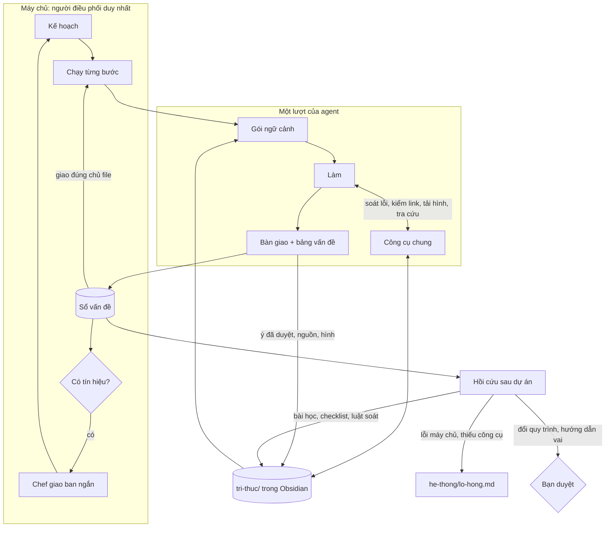

# Kế hoạch nâng cấp trí não Yoga Lab · bản 2

Ngày 19/10/2026. Bản này thay bản 1.
Số liệu lấy từ `workspace/.yogalab/runs.jsonl` (87 lượt chạy), `plans.json` (11 kế hoạch), các file bàn giao, file nhận xét và `kinh-nghiem.md`.
Mục 8 ghi những chỗ bản 1 nói chưa đúng hoặc còn thiếu.

## 0. Tóm tắt

### Năm phát hiện
1. **Chi phí ≈ số lượt × độ dài ngữ cảnh.** 91% token là đọc lại cache. Mỗi lượt thừa đều đọc lại toàn bộ ngữ cảnh: chờ trang Gemini, thử lệnh bị chặn, mở lại link cũ.
2. **Sửa lỗi muộn đắt hơn làm đúng từ đầu.** Vòng duyệt → sửa → duyệt lại tốn ngang hoặc hơn chính bước làm.
3. **Nhóm làm lại cùng một việc.** Suy giáp đã làm 6 bản. Khoảng 40% link mở ở v6 và v7 đã được mở ở bản trước. 11/12 ý tiêu biểu trong danh sách đã duyệt của v7 đã có trong file kiểm chứng v6.
4. **Phần lớn bài học lặp lại không phải lỗi của agent.** Chúng là lỗi máy chủ, thiếu công cụ, thiếu bước trong quy trình, hoặc thiếu một sự thật. Ghi thêm bài học cho agent không chữa được những lỗi này.
5. **Bạn gần như luôn để nhóm tự quyết** (26/27 câu hỏi), nhưng câu hỏi nào cũng làm dự án dừng chờ.

### Năm trụ cột

| Trụ cột | Ý chính |
|---|---|
| T1 · Công cụ chung | Máy chủ cho agent gọi 4 công cụ ngay trong lúc làm: soát lỗi, kiểm link, tải hình, tra bộ não. Nối qua một MCP nội bộ nhỏ, agent vẫn không chạy được lệnh shell. |
| T2 · Sổ vấn đề | Lỗi ghi theo bảng cố định cột, tự giao đúng người phụ trách file. Chef chỉ được gọi "giao ban" khi có tín hiệu cần xử lý. Câu hỏi mặc định không làm dừng dự án. |
| T3 · Bộ não Obsidian | `tri-thuc/`: ý đã kiểm chứng, nguồn, tư thế, hình, quyết định, và quy tắc do chính bạn viết. |
| T4 · Tự học có phân loại gốc lỗi | Mỗi lỗi được xếp vào agent, quy trình, công cụ, môi trường hoặc tri thức, rồi chuyển tới đúng nơi sửa. Lỗi còn lặp thì tự siết thêm một bậc. |
| T5 · Kinh tế token | Deep Research hai pha, chế độ tiếp nối, nghiên cứu phần chênh, duyệt lại hẹp, chọn model theo loại bước. |

Giữ nguyên nguyên tắc hiện tại: **máy chủ là người điều phối duy nhất, agent không gọi nhau trực tiếp.**
Agent "nói chuyện" qua sổ vấn đề, bàn giao có cấu trúc và bộ não chung. Máy chủ đọc, rồi chuyển tới đúng người, đúng lúc.

### Thứ tự
Đợt 0 sửa lỗi và dọn nền → Đợt 1 sổ vấn đề và công cụ chung → Đợt 2 bộ não → Đợt 3 tự học → Đợt 4 tối ưu.
Mỗi đợt có tiêu chí xong đo được (mục 3) và được chạy thử trên dự án thật trước khi sang đợt sau.

## 1. Phát hiện

### 1.1 Token đi đâu

| Loại token (87 lượt) | Token thô | Phần trong token quy đổi |
|---|---|---|
| Đọc cache | 64,5 triệu (91% token thô) | khoảng 50% (tính 1/10) |
| Ghi cache | 4,7 triệu | khoảng 37% |
| Đầu ra | 1,4 triệu | khoảng 11% |
| Đầu vào mới | 0,3 triệu | khoảng 2% |

Chi phí gần như tỉ lệ với số lượt nhân độ dài ngữ cảnh. Ba nguồn lượt thừa lớn nhất:

- **Chờ trên Chrome.** Trong các lượt Mai dùng Chrome, khoảng 45% thao tác là chờ hoặc tải lại trang Gemini. Mỗi lần chờ là một lượt đọc lại khoảng 44 nghìn token ngữ cảnh.
  Mai và Nhi tốn nhất mỗi lần chạy: 250 nghìn và 268 nghìn token quy đổi. Nhi trung bình 59 lượt mỗi lần chạy.
- **Thử công cụ không được cấp.** 46/87 lần chạy (53%) có gọi Bash (chưa tính PowerShell) để đếm chữ, ghi file, liệt kê thư mục. Bash không có trong `claudeTools` nên lần gọi nào cũng bị từ chối và mất lượt.
  Bàn giao ghi rõ: "Không chạy được python để đếm chữ, đếm tay" (Lam, An), "không có công cụ tải" (Vy), "không chạy được script tải hình" (Mai).
- **Vòng sửa** (ước tính theo lượt chạy của từng bước):

| Kế hoạch | Bước làm | Duyệt + sửa + duyệt lại |
|---|---|---|
| v5 (plan-20261016-204631) | 0,40 triệu | 1,70 triệu |
| v6 (plan-20261017-170653) | 1,68 triệu | 1,82 triệu |
| v7 (đang tạm dừng) | 1,68 triệu | 0,81 triệu, chưa xong |

Hệ quả cho thiết kế. Muốn rẻ hơn thì phải:
- để máy chủ làm việc máy móc thay cho lượt của agent;
- cho người làm tự kiểm bằng đúng công cụ người duyệt đang dùng, ngay trước khi bàn giao;
- chỉ đưa vào ngữ cảnh đúng phần cần đọc.

### 1.2 Làm lại cùng một việc
- Suy giáp có 6 bản (v2 → v7). Bản nào cũng nghiên cứu, kiểm chứng, viết, thiết kế lại từ đầu; thư mục output đã 113 MB.
- Link mở ở v6: khoảng 10/23 đã được mở ở bản trước. v7: khoảng 12/33.
- Token quy đổi bước nguồn của Mai tăng dần: v5 0,60 → v6 1,23 → v7 2,14 triệu.
- Lấy 12 ý tiêu biểu trong "Danh sách đã duyệt" của An ở v7 (liều i-ốt, giờ uống thuốc, Hashimoto, n=516…): 11 ý đã có trong file kiểm chứng v6.
  Hiện không có chỗ nào để bản sau dùng lại những ý đã kiểm.

### 1.3 Bài học lặp lại: gốc lỗi thật nằm ở đâu

| Lỗi lặp lại | Có trong bài học của | Gốc lỗi thật | Chỗ sửa đúng |
|---|---|---|---|
| Ảnh tốt nằm ở `hinh-moi/`, không vào `output/<chủ đề>/hinh/` | Hạ (2), Nhi (2), Chef (1) | **Máy chủ**: `imageDirOf` lấy thư mục từ chữ trong nhiệm vụ; nhiệm vụ không ghi đường dẫn thì rơi về `hinh-moi` | Sửa máy chủ (Đợt 0) |
| Lỗi trong slides.md mà không ai giao Lam sửa (`CẦN GIAO LAM`) | Hạ, Chef, Lam | **Quy trình**: `handleReview` chỉ giao sửa cho người làm bước được duyệt | Giao theo chủ file (T2) |
| Số 115 chưa có nguồn Việt Nam | Mai (2), An (2) | **Tri thức**: một sự thật phải tìm lại ở mỗi bản | Lưu vào bộ não (T3) |
| Đếm chữ trên slide bằng tay, đếm sai | Lam, An | **Công cụ**: agent không có công cụ đếm; máy soát chỉ chạy cho người duyệt | `soat_loi` cho người làm (T1) |
| Dòng Hình trong slides.md lệch thiet-ke.md | Lam (3), Hạ (1) | **Công cụ và quy trình**: hai file do hai người viết, không có gì đối chiếu tự động | Máy đối chiếu hai file (T1) |
| StatPearls, Mayo, NICE trả 403 hoặc CAPTCHA | An, Hạ, Mai | **Môi trường và tri thức** | Ghi tình trạng và cách mở khác vào note nguồn (T3) |
| Bàn giao báo "đã sửa" mà file chưa đổi | Hạ, Lam | **Agent**, nhưng máy kiểm được | Máy chủ đối chiếu với file đã ghi (Đợt 0) |
| Ý trên slide thiếu tân ngữ, câu cụt | Lam | **Agent** | Bài học, đúng chỗ |

Trong 8 nhóm lỗi lặp lại, chỉ 1–2 nhóm là lỗi của agent theo đúng nghĩa.
Muốn "tự học" có tác dụng, hệ thống phải biết lỗi thuộc gốc nào để chuyển tới đúng nơi sửa.

### 1.4 Kế hoạch tĩnh, tín hiệu giữa chừng không ai xử lý
Chef chia việc một lần lúc đầu, rồi chỉ được gọi lại khi một bước lỗi hoặc lúc nghiệm thu.
Trong lúc đó, mục "Vướng mắc" của bàn giao có những tín hiệu cần xử lý ngay nhưng không ai đọc tới:
- "Dòng Hình chưa đối chiếu được với thiet-ke.md (Vy chưa viết)": Lam và An cùng để lại cho bước sau (v6).
- "Máy chủ chưa tải 3 link Special:FilePath": Vy, Hạ, Chef cùng báo ở v6, việc này treo tới tận nghiệm thu.
  Sau đó chính Chef rút bài học "nếu máy chủ không tải được thì giao tải tay ngay". Đây là một luật máy chủ làm được, không cần Chef phải nhớ.
- v7: máy chủ tải hình nguồn hỏng 7/20 rồi 5/17 file. Lý do là "Commons không có file này" (tên file đề xuất không có thật) và HTTP 429 (tải dồn).

### 1.5 Câu hỏi cho chủ dự án
- 27 câu hỏi, 1 câu có câu trả lời cụ thể ("giữ với gạch thấp nhất 1–3 phút"). 26 câu còn lại là "nhóm tự quyết", do bạn bấm hoặc do máy chủ tự điền khi hết lượt hỏi.
- Trong riêng v6: số 115 bị hỏi 4 lần, biểu tượng Canva 3 lần, chống chỉ định 5 tư thế 2 lần, mỗi lần một cách viết.
  Bộ so trùng chỉ so 80 ký tự đầu (`qKey`).
- 2 "câu hỏi" thật ra là câu trả lời "Không (…)" hoặc "Không. …", vì `parseQuestions` chỉ nhận chữ "Không" đứng một mình.
- "Vui lòng cấp quyền Chrome" bị hỏi ở 2 dự án. Đây là lỗi môi trường, không phải câu hỏi dành cho chủ dự án.

### 1.6 Lỗi hệ thống tìm thấy khi rà

| # | Lỗi | Ở đâu | Hậu quả |
|---|---|---|---|
| L1 | Ảnh rơi vào `hinh-moi/` khi nhiệm vụ không ghi đường dẫn | `imageDirOf`, `placeImages` | 5 bài học ghi sai chỗ; ảnh tốt không vào bộ hình (v6) |
| L2 | "Không (giải thích…)" bị coi là câu hỏi | `parseQuestions` | Dự án dừng chờ vô cớ |
| L3 | So trùng câu hỏi và bài học chỉ theo 80 ký tự đầu | `qKey`, `newQuestions`, `appendLessons` | Câu hỏi và bài học bị trùng |
| L4 | Mai không có WebSearch, kể cả ở bước sửa | `claudeToolsOf` không xét loại bước | Bước sửa phải đi vòng qua Chrome, có lúc bỏ cuộc ("không tìm được nguồn 115") |
| L5 | Tải hình hỏng: tên file Commons không có thật, HTTP 429; v6 hỏng 3 link Special:FilePath chưa rõ lý do | `downloadSourceImages`, `downloadListedImages`, `imageUrlOf` | Thiếu hình y khoa tới nghiệm thu |
| L6 | Kết quả máy soát chỉ đưa cho người duyệt | `pumpPlan`, `finishPlan` | Người làm đếm tay; lỗi máy móc dồn sang vòng duyệt |
| L7 | `index.md` do agent tự nối thêm dòng | `buildPrompt`, quy tắc 5 | 85 dòng, tăng mãi, lượt nào cũng đọc |

## 2. Thiết kế đích



### T1 · Công cụ chung (MCP nội bộ)

Hơn nửa số lần chạy có thử gọi shell, vì agent thiếu khả năng máy móc. Mở Bash thì không an toàn trên máy bạn.
Thay vào đó, máy chủ cung cấp 4 công cụ an toàn:

| Công cụ | Làm gì | Thay cho |
|---|---|---|
| `soat_loi(file)` | Chạy máy soát hiện có (dấu câu, từ cấm, cách gọi, số chữ từng trang). Thêm: đối chiếu slides.md ↔ thiet-ke.md theo trang; kiểm file trong "Danh sách hình" có thật trong `hinh/` | Đếm tay, thử Bash, lỗi máy móc dồn sang vòng duyệt |
| `kiem_link(urls)` | Máy chủ mở link: sống, 403, 404, CAPTCHA, tiêu đề trang. Link Commons thì kiểm file có thật và đọc giấy phép. Kết quả lưu vào note nguồn, hỏi lại thì trả ngay | WebFetch chỉ để biết link sống; đề xuất hình Commons không có thật |
| `tai_hinh(link, ten)` | Tải hình có giấy phép vào đúng thư mục chủ đề của dự án; Commons trả 429 thì xếp hàng thử lại sau | Thử script tải; ảnh sai thư mục |
| `tra_cuu(tu_khoa, loai?)` | Tìm trong bộ não (ý, nguồn, tư thế, hình, quyết định), trả danh sách gọn kèm đường dẫn | Đọc cả file nguồn 40 KB để tìm một ý |

Thiết kế:
- **MCP chỉ dùng cho truy vấn và hành động.** Dữ liệu nhiều dòng (danh sách lỗi, danh sách ý đã duyệt) vẫn ghi thành bảng trong file.
  Một lần Write rẻ hơn 30 lần gọi công cụ, vì mỗi lần gọi là một lượt đọc lại ngữ cảnh.
- **Cách nối.** Thêm `mcp/yogalab-mcp.js` (stdio, không thêm thư viện). File này chuyển lời gọi về máy chủ qua `127.0.0.1`, kèm khoá riêng của lượt chạy.
  - `startRun` ghi một file cấu hình MCP cho từng lượt.
  - `cliArgs` thêm `--mcp-config <file>` cạnh `--strict-mcp-config` đang có. Dùng đường dẫn file chứ không dùng chuỗi JSON, vì `quoteWinArg` từ chối dấu nháy kép trên Windows.
  - `claudeToolsOf` thêm `mcp__yogalab`, giống cách đang thêm `mcp__claude-in-chrome`.
- Máy chủ biết lượt chạy thuộc dự án nào, nên công cụ tự biết thư mục chủ đề. Ảnh không thể rơi vào `hinh-moi/` nữa.
- **Đường lui.** Engine chưa dùng được MCP (agy, Gemini CLI) vẫn có máy soát chạy sau lượt như hiện nay; các phần khác vẫn chạy bằng bảng trong file.
- **Chi phí.** Phần định nghĩa 4 công cụ khoảng 1–2 nghìn token, nằm trong cache từ lượt thứ hai trở đi.

### T2 · Sổ vấn đề và điều phối thích ứng

**Ghi vấn đề.** Người duyệt vốn đã viết gần đúng dạng này ("**Tr.26, dòng Hình** · BẮT BUỘC · …"), chỉ cần cố định cột thành bảng `## Danh sách vấn đề`:

| Mã | File | Vị trí | Mức | Loại | Vấn đề | Đề xuất |
|---|---|---|---|---|---|---|
| V1 | output/suy-giap-v7/slides.md | Trang 13 | BẮT BUỘC | thieu-nguon | Số 115 chưa có nguồn | Dẫn trang công khai của Bộ Y tế |

Máy chủ đọc bảng (đã có `tableRows`) và ghi vào `du-an/<mã>/van-de.md`, thêm tiền tố bước vào mã. Bảng sai mẫu thì máy chủ ghi vào bảng dự án và nhắc ở bước sau, không bỏ qua im lặng.

**Giao đúng người.** Chủ của file là người được giao file đó trong kế hoạch; mặc định là người đã ghi file đó trong dự án (`slides.md` → Lam, `thiet-ke.md` → Vy, file nguồn → Mai, ảnh → Nhi).
`handleReview` chèn bước sửa cho **từng chủ file còn vấn đề BẮT BUỘC**, không chỉ cho người làm bước được duyệt. Hết lỗi kiểu `CẦN GIAO LAM`.

**Người sửa báo kết quả** bằng bảng `## Đã xử lý` (cột: Mã · Đã sửa / Không sửa · Lý do).
Máy chủ đối chiếu với file thật sự được ghi trong lượt đó (`run.files`). Báo "đã sửa" mà file không đổi thì vấn đề vẫn mở, và người duyệt lại được nhắc.

**Duyệt lại hẹp.** Bước duyệt lại chỉ nhận danh sách vấn đề còn mở kèm vị trí, không nhận cả file nhận xét cũ.

**Tín hiệu từ bàn giao.** Thêm hai mục tuỳ chọn vào mẫu bàn giao:
- `## Gửi đồng đội`: mỗi dòng dạng `@lam: …`. Máy chủ đưa dòng đó vào gói ngữ cảnh ở bước kế tiếp của người được nhắn. Nếu đó là lỗi trong file của họ thì ghi thành vấn đề.
- `## Cho cả nhóm biết`: sự thật có ích cho mọi người, ví dụ "NICE trả 403, Mayo mở được qua Chrome". Máy chủ ghi vào bảng dự án. Lúc hồi cứu sẽ quyết định có đưa vào bộ não không.

**Giao ban: Chef chỉ được gọi khi cần.**
- Sau mỗi bước, máy chủ dò tín hiệu bằng luật, không tốn token: vấn đề chưa có chủ, hình tải hỏng, "Vướng mắc" nhắc tới file chưa có, tin `@chef`.
- Có tín hiệu thì gọi Chef một lượt ngắn (effort thấp, tối đa 6 lượt) với bản tóm tắt tín hiệu. Chef trả JSON chèn tối đa 2 bước. Mỗi dự án tối đa 3 lần giao ban.
- Có tín hiệu máy chủ tự xử lý luôn. Ví dụ: hình tải hỏng → tạo vấn đề cho người đề xuất link (đúng bài học Chef rút ra ở v6).

**Câu hỏi không chặn.**
- Mặc định, câu hỏi cho chủ dự án được ghi thành **giả định** theo phương án đề xuất, và dự án chạy tiếp.
- Bạn xem danh sách "Giả định chờ xác nhận" lúc nào cũng được. Bạn đổi một giả định thì máy chủ tạo vấn đề cho người phụ trách.
- Chỉ dừng chờ khi câu hỏi có nhãn `[CHẶN]` và thuộc an toàn học viên hoặc đổi phạm vi.
- Câu hỏi về môi trường (bật Chrome, hết hạn mức) không đi vào đây, mà vào bước kiểm trước khi chạy.

### T3 · Bộ não trong Obsidian (`tri-thuc/`)

```
workspace/tri-thuc/
├── 00-ban-do.md            ← bản đồ chính (máy chủ sinh, thay index.md cũ)
├── quy-tac-cua-toi.md      ← BẠN viết: quy tắc cao nhất, luôn có trong gói ngữ cảnh
├── chu-de/suy-giap.md      ← MOC chủ đề (máy chủ sinh)
├── menh-de/                ← mỗi ý y khoa đã kiểm chứng là một note
├── nguon/                  ← mỗi nguồn một note: link, tình trạng truy cập, câu trích, cách mở khác
├── tu-the/                 ← chống chỉ định, đạo cụ, biến thể, prompt ảnh đã đạt, lỗi AI hay vẽ sai
├── hinh/                   ← hình có giấy phép đã tải: tác giả, giấy phép, vùng nhãn cần che
├── quyet-dinh/             ← quyết định và giả định theo chủ đề
├── thuat-ngu.md            ← từ nên dùng, từ cần tránh → máy chủ sinh lintBanned, lintVariants
├── ghi-chu-chuyen-mon/     ← BẠN, bác sĩ, giảng viên ghi nhận xét chuyên môn
├── mau-tot/                ← ví dụ đạt chuẩn: một trang slide, một prompt ảnh, một file kiểm chứng gọn
├── bai-hoc/                ← bài học có vòng đời (T4)
└── he-thong/lo-hong.md     ← lỗi máy chủ, thiếu công cụ: việc của người phát triển
```

Ví dụ note ý `menh-de/levothyroxine-uong-luc-doi.md`:
```markdown
---
loai: menh-de
ma: levothyroxine-uong-luc-doi
chu-de: [suy-giap, thuoc]
muc-bang-chung: manh          # manh | vua | so-bo | y-kien
trang-thai: da-duyet          # nhap | da-duyet | can-xem-lai | bac-bo
nguon: ["[[nhs-levothyroxine]]"]
trich: "30 minutes to 1 hour before breakfast"
duyet-boi: an
ngay-duyet: 2026-10-19
xem-lai-truoc: 2027-10-19
dung-trong: ["[[plan-20261019-193827]]"]
---
Uống levothyroxine lúc đói, 30–60 phút trước bữa sáng.

## Cách nói trên slide
"Uống thuốc lúc bụng đói, theo giờ bác sĩ dặn."

## Lưu ý
Không nói "cách 4 giờ" chung chung: 4 giờ chỉ áp dụng cho canxi carbonate và sắt sulfate.
```

Note nguồn có `url`, `to-chuc`, `loai-nguon`, `truy-cap` (ok, 403, 404, captcha), `kiem-luc`, `cach-mo-khac` (ví dụ Europe PMC cho bài PMC), các câu trích đã dùng.
Note tư thế gom phần lớn bài học hiện có của Nhi (gạch nằm phẳng, bắp chân nằm trọn trên ghế…), vì đó là tri thức về tư thế chứ không phải về riêng Nhi.

**Ai ghi, ghi lúc nào**

| Nội dung | Ai cung cấp | Ai ghi note |
|---|---|---|
| Ý đã duyệt | An viết bảng `## Danh sách đã duyệt` cố định cột: Mã · Ý · Mức bằng chứng · Nguồn · Câu trích. Ô Mã lấy từ `tra_cuu` nếu ý đã có, để trống nếu ý mới | Máy chủ tạo hoặc cập nhật note; An không phải ghi từng note |
| Nguồn | Bảng nguồn trong file của Mai thêm cột `Mã nguồn` (ví dụ `nhs-levothyroxine`), để số [n] của từng bản quy về một mã cố định | Máy chủ; `kiem_link` cập nhật tình trạng |
| Hình | Máy chủ tải xong | Máy chủ |
| Quyết định, giả định | Bạn trả lời, hoặc câu hỏi được ghi thành giả định | Máy chủ |
| Tư thế | Khởi tạo từ v7 (ma trận chống chỉ định của An, prompt ảnh đạt của Nhi) | Cập nhật lúc hồi cứu |
| MOC chủ đề, bản đồ | Sau mỗi dự án | Máy chủ |
| Quy tắc của bạn, ghi chú chuyên môn | Bạn, trong Obsidian | Máy chủ không bao giờ ghi vào |

**Agent dùng bộ não thế nào**
- **Mai** đọc MOC chủ đề trước khi tìm. Mai chỉ tìm cho mục chưa có ý đã duyệt, hoặc ý đã quá hạn xem lại. Deep Research chỉ chạy cho phần còn trống.
- **An** bỏ qua ý đã duyệt còn hạn, chỉ kiểm ý mới hoặc ý vừa sửa. Tình trạng link lấy từ note nguồn.
- **Lam** trích theo mã ý, nên hết lệch số [n] giữa file nguồn và kịch bản (bài học của Mai ở v6).
- **Vy, Nhi** lấy hình từ `hinh/`, lấy prompt đã đạt từ `tu-the/`.

**Gói ngữ cảnh** do máy chủ soạn cho từng bước, thay cho "đọc index.md" và "đọc kinh-nghiem.md". Giới hạn khoảng 1.500 từ, gồm:
- quy tắc của bạn;
- quyết định và giả định của chủ đề;
- vấn đề đang mở giao cho người này, tin `@` gửi cho họ;
- bài học khớp loại bước;
- danh sách liên quan trong bộ não (chỉ tên và đường dẫn, cần thì agent tự đọc).

**Phần dành cho bạn trong Obsidian**
- Mở chính `workspace/` làm vault, hoặc trỏ `workspace` trong config vào vault của bạn. Obsidian bỏ qua thư mục ẩn `.yogalab`.
- Bảng lọc theo thuộc tính: Bases (plugin lõi từ Obsidian 1.9) hoặc Dataview. Ví dụ: ý `can-xem-lai`, ý mức `y-kien` nằm trên trang an toàn, nguồn đang 403, tư thế chưa có ảnh đạt.
- Graph view lọc theo `tri-thuc/`: thấy ý nào dựa trên nguồn nào, dự án nào đã dùng.
- Mẫu note trong `tri-thuc/_mau/` để bạn tự thêm ý, quy tắc.
- Trong giao diện web, nút mở thẳng note bằng `obsidian://open?...`.

**Chống tri thức sai lan rộng**
- Chỉ An được đưa ý lên `da-duyet`, và phải có câu trích.
- Mỗi ý có hạn xem lại.
- Bạn đánh `bac-bo` được. Ý `bac-bo` mà còn xuất hiện trong sản phẩm thì máy soát gắn cờ.
- Mỗi dự án, bước duyệt kiểm ngẫu nhiên vài ý cũ.

**Ghi an toàn khi Obsidian đang mở.** Máy chủ không ghi vào file của bạn. Với note dùng chung, máy chủ chỉ sửa các trường của nó. Note có `khoa: true` thì máy chủ không ghi.

### T4 · Vòng tự học có phân loại gốc lỗi

**Tín hiệu để học**, mạnh dần:
1. vấn đề trong sổ (loại và gốc);
2. điểm nghiệm thu theo từng tiêu chí;
3. số liệu lượt chạy: công cụ bị chặn, lỗi công cụ, quá giờ, số lượt so với trung vị;
4. bạn đổi một giả định (tín hiệu mạnh nhất).

**Năm gốc lỗi và nơi sửa**

| Gốc | Ví dụ | Đi đâu |
|---|---|---|
| `agent` | Câu cụt; báo cáo sai sự thật | Bài học theo phạm vi, chỉ hiện ở đúng loại bước |
| `quy-trinh` | Lỗi trong file người khác mà không ai được giao sửa | Đề xuất sửa quy trình hoặc hướng dẫn vai (bạn duyệt) |
| `cong-cu` | Ảnh sai thư mục; thiếu công cụ đếm | `he-thong/lo-hong.md`, việc của người phát triển |
| `moi-truong` | Chrome chưa bật; trang 403; hết hạn mức | Kiểm trước khi chạy; ghi vào note nguồn |
| `tri-thuc` | 115 thiếu nguồn Việt Nam | Bộ não |

Người duyệt ghi `Loại` theo danh mục cố định. Máy chủ gán gốc mặc định theo luật; ví dụ công cụ bị chặn → `cong-cu`. Chef xác nhận lúc hồi cứu.

**Danh mục loại lỗi** (khởi đầu từ dữ liệu hiện có):
`thieu-nguon`, `nguon-khong-khop`, `phong-dai`, `an-toan-thieu-ccd`, `lech-hai-file`, `file-khong-ton-tai`, `anh-sai-tu-the`,
`anh-sai-thu-muc`, `chinh-ta-dau-cau`, `qua-chu`, `thieu-muc-brief`, `link-chet`, `bao-cao-sai-su-that`.

**Bài học có vòng đời** (`tri-thuc/bai-hoc/<mã>.md`):
```yaml
ma: BH-017
goc: agent
pham-vi: vai:bien-tap        # nhom | vai:<vai> | agent:<id> | chu-de:<chủ đề>
ap-dung-khi: [duyet, hinh]   # loại bước, loại file
loai-loi: lech-hai-file
tu-van-de: [V-031, V-058]
bac: 1                       # 1 bài học · 2 checklist · 3 máy kiểm · 4 đổi quy trình
lan-tai-pham: 2
trang-thai: khong-hieu-qua   # moi | hieu-qua | khong-hieu-qua | da-thang-cap | huy
```

**Thang thăng cấp**

| Bậc | Hình thức | Khi nào lên bậc | Ví dụ |
|---|---|---|---|
| 1 | Bài học chữ, chỉ hiện ở đúng loại bước | mặc định | "Đọc lại từng ý như một câu trọn nghĩa" |
| 2 | Dòng bắt buộc trong mục "Tự kiểm" của bàn giao | Lỗi tái phạm sau khi đã có bài học | "Đã chạy `soat_loi` cho slides.md, còn 0 lỗi BẮT BUỘC" |
| 3 | Luật máy soát hoặc kiểm tra của máy chủ | Vẫn tái phạm ở bậc 2 và máy kiểm được | Dòng Hình của slides.md phải khớp thiet-ke.md |
| 4 | Đổi quy trình hoặc hướng dẫn vai | Chef đề xuất, bạn duyệt | Chèn bước kiểm file hình trước bước duyệt ảnh |
| (khác) | Chuyển thành tri thức | Bài học thật ra là một sự thật | "115 cần nguồn Bộ Y tế" thành note ý có nguồn |

**Đo hiệu quả.** Sau mỗi dự án, với mỗi bài học, máy chủ đếm vấn đề cùng loại trong cùng phạm vi.
Không còn thì đánh `hieu-qua`. Còn thì `lan-tai-pham` cộng 1 và đề xuất lên bậc.

**Hồi cứu sau dự án**, thay cho mục "lessons" trong nghiệm thu hiện nay.
- Máy chủ tổng hợp số liệu: vấn đề theo loại, gốc, người; bài học tái phạm; công cụ bị chặn; token theo loại bước.
- Chef trả JSON gồm: bài học cần gộp hoặc viết lại; đề xuất lên bậc; đề xuất sửa hướng dẫn vai dưới dạng dòng cũ → dòng mới; mục mới cho `lo-hong.md`; ý mới cho bộ não.

**Bạn duyệt.**
- Giao diện có mục **Đề xuất cải tiến**, mỗi đề xuất một thẻ với ba nút Duyệt, Sửa, Bỏ. Config được lưu phiên bản để hoàn tác.
- Bài học và tri thức thì không cần duyệt từng cái (quá nhiều và nhỏ), nhưng luôn hiện rõ và hoàn tác được.
- Hướng dẫn vai, quy trình, luật soát chỉ đổi khi bạn bấm Duyệt.

**Mẫu tốt.** Sản phẩm được chấm cao và bài học tích cực ("làm tốt, giữ lại") được lưu thành ví dụ trong `mau-tot/`.
Agent đọc một ví dụ đúng loại, thay vì đọc một đoạn mô tả dài.

### T5 · Kinh tế token
1. **Deep Research hai pha.**
   - Pha khởi chạy: mở Gemini, gửi prompt, duyệt kế hoạch nghiên cứu, ghi link cuộc chat, rồi kết thúc lượt.
   - Máy chủ hẹn giờ chờ, không tốn token.
   - Pha thu hoạch: một lượt mới, ngữ cảnh sạch. Mở link; chưa xong thì hẹn lại sau 10 phút; xong thì lấy báo cáo và tổng hợp.
   - Bỏ được phần chờ đang chiếm khoảng 45% thao tác Chrome của Mai. Prompt hiện đã có ý "dùng lại báo cáo đã lưu" và "ghi link cuộc chat", nên thay đổi gọn.
2. **Chế độ tiếp nối.** Dự án mới cho chủ đề đã có bắt đầu từ bản cuối, mục "Phần còn thiếu" của nghiệm thu, các vấn đề còn mở và bộ não. Chef chỉ lập kế hoạch cho phần chênh.
   File chữ được chép sang thư mục bản mới. Hình dùng lại qua thư viện, không chép lại 113 MB.
3. **Nghiên cứu phần chênh** (T3) và **duyệt lại hẹp** (T2).
4. **Người làm tự soát trước khi bàn giao** bằng `soat_loi` (T1), để lỗi máy móc không dồn sang vòng duyệt.
5. **Gọn phần đọc bắt buộc.** Gói ngữ cảnh thay cho index và kinh-nghiem. Brief tách thành phần lõi (mục tiêu, tiêu chí, ràng buộc) và phụ lục: brief v7 dài 16 KB mà bước nào cũng đọc.
6. **Mai được WebSearch ở bước sửa** (L4). Tìm vài nguồn cụ thể bằng WebSearch rẻ hơn mở Chrome hỏi Gemini.
7. **Chọn model theo loại bước.** Bước duyệt lại các vấn đề máy móc chạy Haiku. Không áp dụng cho agent cần Chrome, vì Haiku không dùng được Claude in Chrome.
8. **Chạy song song các bước độc lập** của những người khác nhau: rút ngắn thời gian chờ, không giảm token.

## 3. Lộ trình theo đợt

### Đợt 0 · Sửa lỗi và dọn nền

| Việc | Sửa ở đâu |
|---|---|
| L1: lấy thư mục ảnh theo chủ đề của dự án (từ brief hoặc các bước trước), không rơi về `hinh-moi/`; không xác định được thì ghi vào bảng dự án | `imageDirOf`, `placeImages` |
| L2: "Không" kèm giải thích nghĩa là không có câu hỏi | `parseQuestions` |
| L3: so trùng gần đúng (tách từ, bỏ dấu, Jaccard ≥ 0,6) cho câu hỏi và bài học | `newQuestions`, `appendLessons` |
| L4: xét loại bước khi chọn công cụ; Mai được WebSearch ở bước sửa | `claudeToolsOf`, `cliArgs` |
| L6: đưa kết quả máy soát vào việc của người sửa, không chỉ người duyệt | `pumpPlan` |
| L7: máy chủ sinh `index.md` (dưới 30 dòng) từ `originIndex`; bỏ quy tắc 5 | `buildPrompt`, hàm mới gọi sau `finishRun` |
| Bước sửa không ghi vào file được giao thì ghi chú cho người duyệt lại | `pumpPlan`, phần `onDone` |
| Câu hỏi không chặn; sổ quyết định và giả định (bản đầu là một file `tri-thuc/quyet-dinh.md`) | `newQuestions`, `askOwner`, `answerPlan`, `buildPlanPrompt` |
| Kiểm trước khi chạy cho agent dùng Chrome, bằng một lượt rất ngắn | `createPlan`, `resumePlan` |
| L5: xếp hàng và thử lại lâu hơn khi Commons trả 429; tái hiện 3 link hỏng ở v6 | `fetchImage`, `downloadSourceImages` |
| Thử nghiệm kỹ thuật MCP trên máy bạn (Windows): một công cụ `soat_loi`; kiểm `claude -p` thấy và gọi được; đo token tăng thêm | `mcp/yogalab-mcp.js` |
| Khung kiểm thử bằng `node --test` (có sẵn trong Node 18, không thêm thư viện), dữ liệu mẫu lấy từ workspace hiện tại | `test/` |

**Xong khi**
- Kiểm thử trên dữ liệu thật đều qua:
  - 2 bài học về 115 của Mai gộp thành 1;
  - 3 câu Canva ở v6 gộp thành 1;
  - "Không (3 câu…)" không bị coi là câu hỏi;
  - nhiệm vụ không ghi đường dẫn vẫn ra đúng `output/<chủ đề>/hinh/`.
- `index.md` dưới 30 dòng.
- Thử nghiệm MCP chạy được trên máy bạn. Nếu không chạy được thì biết rõ vì sao, và T1 chuyển hẳn sang phương án chạy sau lượt.

### Đợt 1 · Sổ vấn đề và công cụ chung

| Việc | Sửa ở đâu |
|---|---|
| Bảng "Danh sách vấn đề" và "Đã xử lý" cố định cột; máy chủ đọc bảng, ghi `van-de.md`, báo khi bảng sai mẫu | `lib/van-de.js` (mới), `handleReview` |
| Bảng chủ file; giao sửa theo chủ file; duyệt lại hẹp | `handleReview`, `pumpPlan` |
| Mục "Gửi đồng đội", "Cho cả nhóm biết" trong mẫu bàn giao; máy chủ chuyển tin | `buildPrompt`, `pumpPlan` |
| Giao ban theo tín hiệu, có giới hạn | `pumpPlan`, `runCoordinator` |
| MCP: `soat_loi` (kèm đối chiếu hai file, kiểm file hình), `kiem_link`, `tai_hinh` | `mcp/yogalab-mcp.js`, `lib/cong-cu.js` (mới), `startRun`, `cliArgs`, `claudeToolsOf` |
| Bảng việc hiện số vấn đề mở trên từng thẻ; ngăn chi tiết liệt kê vấn đề | `public/index.html` |

**Xong khi** chạy thử một dự án và thấy:
- Mọi vấn đề BẮT BUỘC trong file nhận xét đều có trong `van-de.md` và đều có chủ.
- Không còn vấn đề nào nằm trong file của người không được giao sửa.
- Số lần chạy có gọi Bash giảm từ 53% xuống dưới 5%.
- Không có ảnh nào nằm ngoài `output/<chủ đề>/`.

### Đợt 2 · Bộ não

| Việc | Sửa ở đâu |
|---|---|
| Khung `tri-thuc/`, mẫu note, bộ ghi của máy chủ (tạo, cập nhật note từ bảng; chỉ sửa trường của mình) | `lib/tri-thuc.js` (mới) |
| Nhập kho ban đầu từ v7: "Danh sách đã duyệt" của An, bảng nguồn và bảng hình của Mai, ma trận chống chỉ định, prompt ảnh đạt. Ý chưa có câu trích để `nhap`, chờ An xác nhận ở dự án sau | script một lần |
| Công cụ `tra_cuu`; gói ngữ cảnh có phần "bộ não liên quan" | `lib/cong-cu.js`, `buildPrompt` |
| Sửa hướng dẫn Mai (nghiên cứu phần chênh), An (bỏ qua ý đã duyệt còn hạn), Lam (trích theo mã) | `config.json` |
| `thuat-ngu.md` sinh `lintBanned`, `lintVariants` | `lintText` |
| Chế độ tiếp nối khi tạo dự án | `createPlan`, `buildPlanPrompt`, giao diện Dự án |
| Nút mở note trong Obsidian | `public/index.html` |

**Xong khi** chạy v8 tiếp nối từ v7 và thấy:
- Token quy đổi bước nguồn của Mai dưới 0,8 triệu (v7: 2,14 triệu).
- Link mở lại dù đã có trong note nguồn còn hạn: dưới 10% (v7: khoảng 36%).
- Bạn mở Obsidian thấy MOC suy giáp và lọc được các ý cần xem lại.

### Đợt 3 · Tự học

| Việc | Sửa ở đâu |
|---|---|
| Danh mục loại lỗi, gốc lỗi; máy chủ gán gốc mặc định theo luật | `lib/bai-hoc.js` (mới) |
| Chuyển bài học trong 7 file `kinh-nghiem.md` sang dạng mới: gắn loại, phạm vi, "áp dụng khi"; tách các bài thật ra là lỗi máy chủ hoặc tri thức | script một lần + bạn xem lại |
| Gói ngữ cảnh chỉ đưa bài học khớp loại bước | `buildPrompt` |
| Đếm tái phạm, đề xuất lên bậc | `lib/bai-hoc.js` |
| Hồi cứu sau dự án thay cho mục "lessons" của nghiệm thu | `finishPlan` |
| Giao diện "Đề xuất cải tiến" (duyệt, sửa, bỏ); lưu phiên bản config để hoàn tác | `public/index.html`, `saveConfig` |
| Thư mục `mau-tot/` | `finishPlan` |

**Xong khi**, sau 2 dự án:
- Bài học nào cũng có trạng thái hiệu quả hoặc tái phạm.
- Ít nhất một lỗi lặp lại đã được thăng cấp thành luật máy soát và không tái phạm.
- Không còn bài học gốc `cong-cu` nằm trong bài học của agent.

### Đợt 4 · Tối ưu và đo
- Deep Research hai pha.
- Model theo loại bước (key mới `stepModel` trong config, cùng kiểu với `stepEffort`).
- Chạy song song các bước độc lập.
- (Thử nghiệm) Hỏi nhanh đồng nghiệp. Agent hỏi một câu; máy chủ chạy một lượt rất ngắn của người được hỏi và trả lời ngay trong lượt đó. Có giới hạn số lần mỗi dự án.
- Trang Báo cáo thêm các chỉ số ở mục 5.

**Xong khi** các chỉ số ở mục 5 đạt mục tiêu trong 2 dự án liên tiếp.

## 4. Lựa chọn thiết kế và lý do

| Câu hỏi | Chọn | Vì sao | Không chọn |
|---|---|---|---|
| Agent có gọi nhau trực tiếp không? | Không; máy chủ chuyển tin | Giữ được ngân sách, thứ tự, nhật ký | Agent tự gọi agent: khó kiểm chi phí, khó lần lại |
| Dữ liệu có cấu trúc ghi bằng gì? | Bảng Markdown cố định cột trong file | Bạn đọc được trong Obsidian; chỉ ghi một lần; máy chủ đã có `tableRows` | Khối JSON riêng (ghi hai lần cùng nội dung); gọi công cụ cho từng dòng (mỗi lần là một lượt) |
| MCP dùng để làm gì? | Chỉ truy vấn và hành động, 4 công cụ | Cho agent đúng khả năng họ đang thiếu mà không mở shell | Mở Bash: rủi ro trên máy bạn |
| Mỗi ý một note, hay mỗi chủ đề một file? | Mỗi ý một note, do máy chủ viết | Trạng thái và nguồn theo từng ý; có graph trong Obsidian; agent đọc qua `tra_cuu` nên không tốn thêm lượt | Một file lớn: phải đọc cả file, khó đánh dấu từng ý |
| Tìm trong bộ não bằng gì? | Thẻ và từ khoá trên frontmatter | Vài trăm note là đủ; không thêm phụ thuộc | Vector DB: thêm hạ tầng khi chưa cần |
| Có tự sửa hướng dẫn agent không? | Chỉ đề xuất, bạn duyệt | Tránh trôi hướng; có hoàn tác | Tự áp dụng |
| Bài học và tri thức có cần duyệt không? | Không, nhưng hiện rõ và hoàn tác được | Nhiều và nhỏ; duyệt từng cái sẽ thành gánh nặng | Duyệt từng bài |

## 5. Chỉ số và mục tiêu

| Chỉ số | Hiện tại | Mục tiêu |
|---|---|---|
| Token quy đổi bước nguồn của Mai | 2,14 triệu (v7) | dưới 0,8 triệu khi tiếp nối |
| Link mở lại dù bản trước đã kiểm | khoảng 36–43% | dưới 10% |
| Lần chạy có gọi Bash | 53% | dưới 5% |
| Vòng duyệt–sửa so với bước làm | 1,1–4,2 lần | dưới 0,6 lần |
| Câu hỏi làm dự án dừng | mọi câu (27) | chỉ câu `[CHẶN]` |
| Câu hỏi trùng trong một dự án | 115 hỏi 4 lần, Canva 3 lần | 0 |
| Lỗi cùng loại tái phạm khi đã có bài học bậc 2 trở lên | nhiều | 0 |
| Điểm nghiệm thu lần đầu | 87 (v5), 80 (v6) | từ 85 trở lên |
| `index.md` | 85 dòng, tăng mãi | dưới 30 dòng |
| Ảnh nằm ngoài `output/<chủ đề>/` | có (v6) | 0 |

## 6. Rủi ro

| Rủi ro | Cách chặn |
|---|---|
| MCP chạy không ổn với Claude Code trên Windows | Thử nghiệm ngay Đợt 0; tính năng nào cũng có đường lui chạy sau lượt |
| Bảng sai mẫu, máy chủ đọc sai | Bộ đọc dễ dãi; sai mẫu thì ghi bảng dự án và nhắc ở bước sau |
| Tri thức sai lan sang dự án sau | Chỉ An đưa lên `da-duyet`; bắt buộc câu trích; có hạn xem lại; bạn đánh `bac-bo`; kiểm ngẫu nhiên ý cũ |
| Hướng dẫn agent trôi dần | Mọi thay đổi qua bạn duyệt, có phiên bản và hoàn tác |
| Giao ban làm phình kế hoạch | Chỉ gọi khi có tín hiệu; tối đa 3 lần, mỗi lần tối đa 2 bước; vẫn tính vào ngân sách |
| Câu hỏi không chặn bỏ qua chuyện quan trọng | Nhãn `[CHẶN]` cho an toàn và phạm vi; danh sách giả định luôn hiện để bạn xem |
| Bạn sửa note đúng lúc máy chủ ghi | Máy chủ không ghi vào file của bạn; chỉ sửa trường của mình; tôn trọng `khoa: true` |
| `server.js` (150 KB) khó sửa thêm | Phần mới đặt trong `lib/`, có kiểm thử `node --test` |

## 7. Cần bạn quyết
1. Bạn mở `workspace/` bằng Obsidian, hay có vault riêng? Câu trả lời quyết định chỗ đặt `tri-thuc/`.
2. Đồng ý để câu hỏi mặc định không chặn, chỉ chặn với an toàn học viên và đổi phạm vi?
3. Đồng ý thêm 4 công cụ MCP nội bộ? Agent vẫn không chạy được lệnh shell.
4. Dự án chạy thử của Đợt 2: tiếp nối v7 thành v8, hay một chủ đề mới?

## 8. Khác gì bản 1
- **Sửa số liệu.**
  - Câu 115 bị hỏi 4 lần trong cùng v6, không phải qua 2 dự án.
  - Mai lỗi 6/19 lượt nhưng chỉ 3 lượt do quyền Chrome; 3 lượt còn lại do Gemini CLI chưa tin thư mục, agy chặn lệnh, và chờ Gemini quá giờ.
  - Việc cắt bài học theo độ mới chưa xảy ra (Mai nhiều nhất 16/30 bài). Đó là rủi ro tương lai, chưa phải lỗi hiện tại.
- **Thêm phân tích chi phí**: đọc cache chiếm 91% token thô; vòng sửa tốn ngang hoặc hơn bước làm; thời gian chờ trên Chrome; số lần thử lệnh bị chặn.
- **Thêm phân loại gốc lỗi**, sau khi thấy nhiều "bài học lặp lại" thật ra là lỗi máy chủ hoặc thiếu công cụ (ví dụ ảnh vào `hinh-moi/` do `imageDirOf`).
- **Thêm công cụ chung qua MCP.** Bản 1 chỉ có phân tích bàn giao sau lượt.
- **Bỏ khối JSON trong bàn giao của người duyệt**, thay bằng bảng cố định cột trong file nhận xét: đọc được trong Obsidian, không phải ghi hai lần.
- **Thêm** câu hỏi không chặn, giao ban theo tín hiệu, Deep Research hai pha, danh sách lỗi hệ thống, và tiêu chí xong cho từng đợt.
